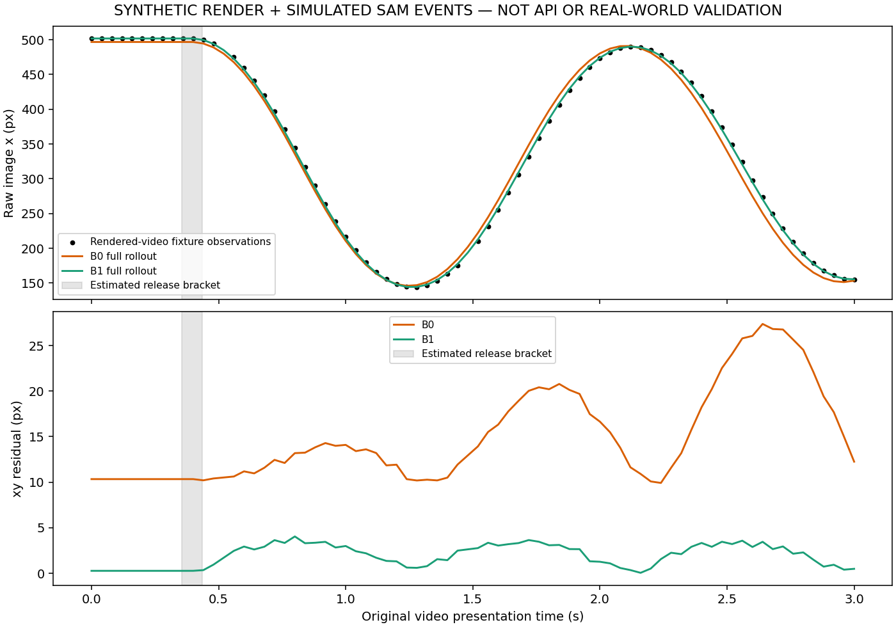

# G2 Perception Readiness

**G2: NOT PASSED — real-world checks pending**

## Implemented and verified offline

Original integer video PTS/time base, display-frame mapping, official SAM parser, mask-contour centers and tracking QA, planar/lens calibration, release-time estimation, stationary/manual uncertainty, common timing uncertainty, and B0/B1/B2 integration.

Offline verification: **PASS**.

## Actual Meta API verification

Status: **not_run**. Successful calls: 0; failed calls: 0.

API fixture tests are not counted as network calls. No raw SDK errors, headers or keys are persisted.

## Actual real recordings

**None supplied or validated.** No physical measurements, measured camera errors, real tracking noise or real baseline scores are claimed.

## Synthetic rendered video / simulated API fixture

**SYNTHETIC ONLY — SIMULATED API EVENTS; NO META API VERIFICATION**

- PASS: rendered mask centers within 1 px RMS
- PASS: all original PTS retained in trial observations
- PASS: two deliberate missing masks stay invalid in each recording
- PASS: release offset estimated within 40 ms of rendered onset
- PASS: synthetic checkpoint calibration RMS below 0.001 px
- PASS: B1 converges using exploration recordings only
- PASS: unseen B1 rollout within 10 px timing/measurement design allowance
- PASS: no fabricated second pivot on a free pendulum

Tracking center RMS: 0.389472 px against known rendered centers.
Calibration checkpoint RMS: 1.63341e-06 px (synthetic correspondences).

| Baseline | Training xy RMS (px) | Unseen recording xy RMS (px) |
|---|---:|---:|
| B0 | 16.1694 | 15.9549 |
| B1 | 2.3731 | 2.3023 |

B2: one_circle_only. Radial geometry is an observation-conditioned diagnostic, not a trajectory prediction.

## Acceptance blockers and limitations

- actual SAM-processed exploration/development phone recordings not validated
- measured calibration with at least four disjoint checkpoints pending
- at least 20 manual frame checks within a 2 px design budget pending
- three repeat releases and separation of release variability pending
- disjoint real B0/B1/B2 comparison pending

Release-onset profiling assumes a visible stationary from-rest lead-in; its uncertainty is approximate until manually checked on real clips. Release-time covariance is common across frames. Repeat trajectory dispersion is not automatically treated as tracker noise.

Lens distortion is corrected only with measured intrinsics. Plane/pivot/scale/gravity errors, rolling shutter, stabilization, nonplanarity, contour bias and annotation uncertainty remain systematic limitations. Quality budgets (1 px calibration, 2 px manual tracking, 10% rejection, 50 ms timing sigma) are declared engineering targets, not measured SAM performance. Full G3 power/MDE and causal claims remain outside this phase.

Source SHA-256: 9cea31fa3eba7b37c7995933c88b16bfdf37a69bb6d2937e0eb622f72b0e2ba8.
Environment: {"meta-sam-parser": "0.1.0", "numpy": "2.3.4", "openai": "1.109.1", "opencv-python-headless": "4.13.0.92", "python": "3.14.0", "scipy": "1.16.3"}.

Follow docs/REAL_DATA_COLLECTION_PROTOCOL.md and docs/G2_IMPLEMENTATION.md for inputs and commands.

Official contracts: [Meta SAM cookbook](https://dev.meta.ai/docs/cookbook/sam-api-basics), [Meta parser](https://dev.meta.ai/docs/sam/client-libraries), [OpenCV calibration](https://docs.opencv.org/4.x/d9/d0c/group__calib3d.html), [ffprobe](https://ffmpeg.org/ffprobe.html).
