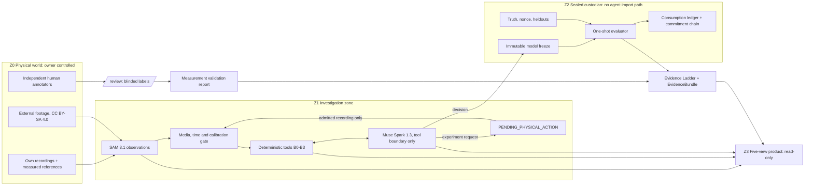

# REALIGN Architecture vFinal

**Status:** delta-only release architecture for commit `88b1e13a756c369e4131769ce734ab4dff843ea4`. Not a certification of physical validation.
**Target repo path:** `docs/ARCHITECTURE_VFINAL.md`

## 0. Source basis and limits (read first)

- **I could not read the repository at `88b1e13`.** The GitHub page reachable from my environment returned an older cached snapshot (3 commits, a README that only describes G1 and B0-B2), and GitHub blocks automated access to file-tree and commit pages.
- Everything below about the code comes from `REALIGN_Architecture_vFinal_Execution_Contract.md` (which cites `AGENTS.md`, `docs/REALIGN_Build_Spec_v1.md`, `docs/IMPLEMENTATION_CORRECTIONS.md`, `docs/TASK06_IMPLEMENTATION.md`, `artifacts/task06/TASK06_READINESS.md`, `docs/META_COMPLIANCE.md` and the G5 artifacts) and from the earlier project documents and screenshots of the hackathon rubric.
- **No source-code defect is asserted.** Items marked **VERIFY** are hypotheses Codex must confirm against the code before acting. Where a new file is named, it is **NEW (proposed)** and Codex must reuse an equivalent module if one already exists.
- Existing identifiers are kept: source domains `SYNTHETIC | REAL_EXTERNAL | REAL_PHONE`, policies `LIVE_MUSE | DETERMINISTIC | MOCK_POLICY`, the five views and `/review`.

## 1. Decision summary

The five logical layers stay in one modular application. vFinal adds no layer, agent, service, physical domain or generic compiler. It adds ten deltas, chosen because each closes a gap a judge could see.

| # | Delta | WHY | HOW it is proved |
|---|---|---|---|
| D1 | **Evidence Ladder**: the product headline is computed from evidence artifacts, never typed by hand | Real-vs-synthetic confusion is the largest credibility risk | Golden test: current repo state renders the expected level; deleting an artifact lowers it |
| D2 | **Evidence header contract**: every API payload carries domain, policy, run id, stage, and the UI refuses to render a payload without them | Labels must be impossible to omit | Contract test on every endpoint, including `/api/closure`, and a UI error-state test |
| D3 | **Blinded annotation workflow** in `/review`, extended into the 0-4 s failure interval | Closes the human reference deficit without letting the tracker bias the labels | Test that tracker output is absent from the annotation payload until the label file is locked |
| D4 | **Physical pending-action state machine** with a media admission validator | A software agent cannot produce observations, and malformed media must be rejected with reasons | Fixture suite of malformed media with typed error codes |
| D5 | **Calibration and timing grades** (`NONE`, `PARTIAL`, `SUFFICIENT`) gating units and claims | The external clip has unknown capture time base and scale, and must never be shown in millimetres | Test that mm output and physical fits are refused below `SUFFICIENT` |
| D6 | **Sealed-evaluation hardening and adversarial tests** (registration hash, consumption ledger, domain-separated commitment) | One-shot evaluation must survive tampering | Adversarial test list in `CODEX_TASK_VFINAL.md`, Stage 3 |
| D7 | **G5 failure analysis**, descriptive only, plus an optional pre-registered ensemble that never replaces the failure | The randomized failure (14.477706 mm vs 10 mm) is the most informative result in the project | Ledger test proving the consumed heldout cannot affect an acceptance result |
| D8 | **Agent-value report** in the Model Decision view, with a computed "no advantage demonstrated" label | Muse and the deterministic comparator matched in the recorded example | Rule test on the recorded case |
| D9 | **Safe `Run locally` panel** and CLI commands | The browser cannot start an investigation, by design | Test that no endpoint can trigger a credentialed API call |
| D10 | **Release package**: rewritten README, evidence index, third-party notices, truthful CI, clean-worktree test run | README is stale, CI was unfinished, and one local run failed on an edit-during-test source-hash mismatch | Release script exit code, plus CI link recorded in `docs/RELEASE_READINESS.md` |

## 2. Architecture and trust boundaries

### Boundary invariants and how each is enforced

| # | Invariant | Enforced by | Honest limit |
|---|---|---|---|
| B1 | Source domain labels cannot be relabelled | Immutable field in `RecordingManifest`; hash-bound | A local file hash is not an external attestation |
| B2 | Muse sees numeric tool outputs only: no heldouts, truth, nonce or sealed metrics, and no raw frames | Tool allowlist schema plus a forbidden-key scan on every `ToolOutputEnvelope` | Software boundary, not adversarial-proof |
| B3 | No import path from the agent or product-API layers to the sealed validator modules | Import-boundary test over `src/realign/agent/` and `src/realign/product/` against `src/realign/validation/` | Custodian trust is not trustless security |
| B4 | The commitment precedes the investigation | Commitment pushed to the public repo before the start receipt | Local chronology and hash integrity are not external timestamps; the public git push is the only external timestamp |
| B5 | Offline replay is read-only; live mode never silently falls back to a mock | Replay opens artifacts read-only; policy is recorded in the run header | None |
| B6 | A frozen model never changes after scoring | Content-hashed `FrozenModel`; any change is a new version needing a new heldout | None |
| B7 | A measurement-quality finding never claims a correction was applied | Decision label `CORRECTION_REQUIRED` until a verified correction record exists | None |
| B8 | No credentials reach the browser, and no browser action triggers a paid API call | Endpoint audit test | None |

## 3. Evidence Ladder (D1)

The header shows the highest level whose prerequisites are all met, and lists the unmet prerequisites of the next level. A permanent "negative results" strip shows the G5 randomized failure and the Muse-equals-comparator result.

| Level | Meaning | Prerequisite artifacts | Status per the contract |
|---|---|---|---|
| C0 | Synthetic physics verified | G1 report | ACHIEVED |
| C1 | Synthetic B0-B3 comparison | Baseline reports | ACHIEVED |
| C2 | Live Muse investigation on synthetic data | One accepted two-round live trace with a real experiment request | ACHIEVED |
| C2-G5 | Synthetic workflow exercise: fixed control PASS (0.6930905745 px RMSE, 5.602553 mm), randomized `SYNTHETIC_VALIDATION_FAIL` (0.7519408442 px, 14.477706 mm vs 10 mm) | Both G5 artifacts | ACHIEVED, with the failure shown |
| C3a | SAM tracks real external footage (600 mask records, 550 accepted centers) | SAM receipts | ACHIEVED, accuracy `NOT_VALIDATED` |
| C3b | Human-validated localization | Complete blinded labels, error, bias and p95 report | BLOCKED: human review |
| C4 | Calibrated trajectory from own phone | Admitted own recordings plus `SUFFICIENT` calibration | BLOCKED_INPUTS |
| C5 | Real physical agent loop | C4 plus an admitted requested recording | BLOCKED_INPUTS |
| C6 | Real sealed assessment | C5 plus an independent custodian, fresh heldout, reveal | BLOCKED_INPUTS |

## 4. Integration contracts

Codex must extend existing dataclasses or schemas in `src/realign/` where an equivalent exists (**VERIFY**), not duplicate them.

| Link | Contract | Required fields | Rejection or abstention condition |
|---|---|---|---|
| Capture to system | `RecordingManifest` | sha256, source domain, role (`stationary`, `free`, `peg`, `requested_experiment`), device and rig id, PTS source, nominal fps, license, operator | Unreadable container, no video stream, variable frame rate beyond tolerance, missing PTS, duplicate hash, zero length |
| SAM to science | `ObservationSet` | Per-frame PTS, mask id, center px, area, shape QA flags, accepted flag, rejection reason, SAM request id, model id `sam-3.1`, prompt text | Rejected frames stay as gaps and are never interpolated; below the coverage threshold the clip is not admitted for fitting |
| Calibration | `CalibrationRecord` | Scale px/m with reference object and uncertainty, pivot px, roll, noise sigma with source clip hash, capture-time verification, `grade` | Missing any field gives `PARTIAL` or `NONE`; below `SUFFICIENT` there are no mm units and no physical fit |
| Science to Muse | `ToolOutputEnvelope` | Tool name, input hash, numeric outputs with units, domain, stage, forbidden-key scan result | Any forbidden key aborts the call and logs a violation |
| Muse to physical world | `PendingExperiment` | Id, requested release side and angle bracket, candidate scores computed by code, rationale hash, state, admission checklist | Stays `PENDING_PHYSICAL_ACTION` until an admitted recording exists, then the budget expiry gives `ABSTAIN` |
| Decision to freeze | `FrozenModel` | Decision enum, spec hash, fitted parameters, exploration trial hashes, tool-trace chain head, code SHA, challenge id, validator protocol hash, content hash | Any field missing means no freeze |
| Custodian to verdict | `EvaluationReport` | Challenge id, domain-separated commitment, start receipt, consumed heldout ids, registration hash, trajectory RMSE, geometry error mm, outcome label, reveal verification | Consumed heldout, registration hash mismatch or commitment mismatch means refusal |
| Export | `EvidenceBundle` | Hash manifest of every artifact, Evidence Ladder state, tool versions, license table, billed API usage | Replay verifies every hash read-only and shows the first mismatch |

## 5. Scientific audit

Classes: **IMPOSSIBLE** (scientifically unattainable from the data), **MISSING DATA**, **IMPL?** (possible implementation defect, unconfirmed), **UX** (unfinished usability).

| # | Finding | Class | Evidence and required action |
|---|---|---|---|
| F1 | Randomized G5 shows low trajectory error with a geometry error above tolerance | **Undetermined: weak identifiability or IMPL?** | A trajectory error of 0.75 px is near the noise floor, so trajectory fit does not constrain peg geometry at that scale. The earlier baseline report showed a similar pattern (off-vertical peg, 16.77 mm error). If the G5 scale matches the 600 px/m used there (**VERIFY**), 14.48 mm is about 8.7 px, which suggests geometry is weakly determined by trajectory. This cannot be settled from documents. Stage 4 decides it with descriptive diagnostics. |
| F2 | Muse and the deterministic comparator matched in predictive error | Result, not a defect | No superiority claim. The contribution claim is limited to a traceable tool-using investigation. |
| F3 | Structural repair is selection and fitting of the predefined `PEG_ONE_SIDE` model | Scope boundary | Label it "structured selection among predefined typed models" in the UI and README. |
| F4 | External clip has unknown capture time base and physical scale | **IMPOSSIBLE** without calibration | Permanent `PTS_ONLY`, scale `UNKNOWN`; it can never enter physical fitting. |
| F5 | All 50 SAM shape rejections fall in the first 4 s, and the existing clean frames start near 5.23 s | **MISSING DATA** | Quality assurance is biased toward the easy interval, so human labels must sample the 0-4 s interval including invalid frames. |
| F6 | `external_reviews.ai_visual.json` contains AI labels with an assumed 3 px sigma | Integrity risk | Keep strictly separate from human ground truth. |
| F7 | No controlled own recordings, so no physical-model claim | **MISSING DATA** | Code cannot close it. The ladder caps at C3a. |
| F8 | Full local test run failed on an edit-during-test source-hash mismatch, and CI for `88b1e13` was unfinished at audit | **IMPL?** (process) | Run tests from a clean worktree (Stage 0). Do not report CI as green until it is. |
| F9 | README is stale | UX | Rewrite (Stage 7). |
| F10 | Browser serves recorded evidence but cannot start an investigation | UX (by design) | Add the safe `Run locally` panel (D9). |
| F11 | Software boundary around the sealed zone | Limit | State it plainly and do not claim trustlessness. |

## 6. Product design

Keep the existing visual identity. No dashboard redesign: the anti-project list in the rubric includes "dashboards as the main feature", so the product must read as an investigation workflow, not a metrics wall.

### Global shell (all views)

- **Evidence header:** domain chip, policy chip, run id, stage (exploration, frozen, post-reveal), and the Evidence Ladder level with the next unmet prerequisite.
- **Domain colouring:** one colour per domain, fixed across all views and recordings. Mixed-domain content in one panel is forbidden except in an explicit split comparison with a banner naming both domains.
- **Non-removable watermark** on any `REAL_EXTERNAL` frame: "External footage, not our experiment, with source and license."
- **Negative-results strip** (always visible): G5 randomized failure, and "no predictive advantage demonstrated" when the agent-value rule fires.

### Views

| View | Must show | Behaviour |
|---|---|---|
| **Reality vs Simulation** | Observation and prediction in separate panes, residual strip, calibration grade chip, frame scrubber, mask overlay toggle | Units toggle (px, mm) is disabled below `SUFFICIENT` calibration. Rejected frames render as gaps. Original PTS is preserved on the time axis. B2 radial error never shares a trajectory-RMSE axis. |
| **Investigation** | Muse timeline: tool name, input hash, numeric outputs, model id, request id, latency, cost, LIVE or REPLAY tag; hypothesis ledger; compiler rejections with codes | "Sealed zone: not accessible" markers where redaction applies. Live traces are never overwritten by replay. |
| **Experiment Loop** | Candidate table with code-computed scores and Muse's choice with rationale; `PendingExperiment` card with instructions, checklist and upload dropzone | In real mode the loop halts at `PENDING_PHYSICAL_ACTION`. A "simulated response" control exists only in synthetic mode and tags everything it produces `SYNTHETIC`. |
| **Model Decision** | B0, B1, B2, B3 and Muse-selected side by side (exploration fit and held-out error), the five outcomes, geometry with credible interval, abstention panel, agent-value verdict | The label "structured selection among predefined typed models" is always visible. Trajectory RMSE, B2 radial error, geometry error mm, SAM acceptance rate and manual localization accuracy are never presented on one scale. |
| **Evidence** | Evidence Ladder, gate table with registered thresholds beside results (G5 fixed PASS and randomized FAIL), commitment and reveal status, consumption ledger, license table, unresolved compliance items, bundle export and replay verification | Registered thresholds are displayed read-only. A tamper detection shows the first mismatching hash. |
| **/review (annotation)** | Frame queue, click capture, annotator identity, independence statement, completion meter, lock button | See D3 below. |

### Annotation workflow (D3)

- Serve frames **without** overlays, in randomized order, drawn from `artifacts/task05/external_yellow_disc/manual_reviews.template.json` and extended into 0-4 s including invalid frames.
- The annotator clicks the object centre or marks "not visible". The tracker output and the AI labels are withheld until the label file is locked.
- On lock, write `manual_reviews.json` (hash-bound to frame hashes and original PTS) and compute error, bias and p95 against SAM, grouped by accepted versus rejected frames, plus reviewer repeatability if there are two annotators. A single annotator who is also the author is reported as such, with the independence limit stated.
- If no human file exists, accuracy shows `NOT_VALIDATED`. AI labels are never ground truth.

### UI state matrix

| Situation | Trigger | Required UI | Forbidden |
|---|---|---|---|
| Live Muse run | Policy `LIVE_MUSE` with receipts | Live badge, request ids, cost | Hiding cost or mixing with replay |
| Replay | Read-only bundle | Replay badge, hash verification result | Presenting replay as live |
| API key absent | No credentials | Message naming replay as the available mode | Silent fallback to a mock |
| Physical input unavailable | `PENDING_PHYSICAL_ACTION` | Instructions, checklist, upload, decision shows "inconclusive: awaiting evidence" | Auto-filled data |
| Media rejected | Admission validator fails | Typed reason and what to re-record | Partial ingest |
| Calibration insufficient | Grade below `SUFFICIENT` | Pixel-only mode with an explanatory banner | Millimetre values |
| Validator failure | Geometry above registered tolerance | Red verdict beside the green trajectory fit, with the numbers | Showing only the fit metric |
| Heldout result | Post-reveal | Single result, ledger entry, thresholds as registered | Re-running a consumed heldout |
| Missing or tampered artifact | Hash mismatch | First mismatch shown, ladder level lowered | Hiding the missing item |

## 7. Research integrity rules

1. Preserve the randomized G5 failure and the fixed positive control exactly as recorded.
2. Never change a registered threshold after seeing hidden geometry, and never use a consumed heldout for tuning.
3. A post-mortem on the consumed case is allowed only as labelled descriptive analysis (`POST_MORTEM`) that cannot affect any acceptance result. Any estimator change afterwards is judged on fresh pre-registered seeds, reported beside G5-v1, and never replaces it.
4. No claim of Muse superiority while the comparator matches, no claim of equation discovery for `PEG_ONE_SIDE`, no causal-uniqueness claim.
5. AI labels, mock policies and synthetic results are never presented as real or human-verified evidence.

## 8. Impact and delivery

### Why a lab would use it

A small robotics or mechatronics lab modifies a mechanism (adds a stop, changes a pivot, wears a part) and must decide whether its simulator can still be trusted for controller tests. REALIGN gives a replayable audit: whether the model disagrees with measurement beyond noise, what kind of fault is plausible, which experiment would discriminate, which typed model candidate fits, whether the evidence is enough, or an honest "inconclusive". The cost per audit comes from billed usage recorded in the bundle; do not state a figure until Codex records it.

### Reproducible demonstration

Replay from the evidence bundle needs no API key and no paid call. The live run uses the explicit CLI command from the `Run locally` panel. Both are labelled. Record a continuous screen capture; a screenshot montage is a labelled fallback only.

### Video storyboard (target 2 to 3 minutes; confirm the portal limit)

1. Hook: a lab cannot tell if its simulator still matches the machine.
2. Evidence Ladder on screen: what is proven, what is locked and why.
3. Synthetic ambiguous case, Muse requests an experiment (live trace).
4. Model comparison: B0-B3 versus the selected model, with the "no advantage demonstrated" label.
5. The honest G5 result: fixed PASS, randomized FAIL.
6. SAM on real footage, as numbers and plots (see rights below), with the annotation error if labels exist.
7. Close: export and verify the evidence bundle.

If own controlled recordings exist by then, they replace step 6 and unlock C4 or above. Do not imply otherwise if they do not.

### Official Meta evidence

Collect Meta Model API receipts (request ids, model ids `muse-spark-1.3` and `sam-3.1`, billed usage) into `artifacts/release/meta_evidence_index.md`. Do not rerun calls for decoration.

### Rights assessment: CC BY-SA 4.0 external footage (not legal advice)

- **Attribution** is required in any retained artifact: creator, title, source link, license, and an indication of changes.
- **ShareAlike:** overlays, masks, trimming and frame extractions are likely Adapted Material that must carry BY-SA or a compatible license. Whether a combined demo video counts as an adaptation or a collection is ambiguous, so treat any frame with overlay as adapted.
- **Conflict:** hackathon submission terms typically grant the organizer broad use of the submission. The owner may not be able to grant that over BY-SA material on other terms. This is **UNRESOLVED** until the official terms are read and the organizer answers in writing.
- **Repo:** the MIT license cannot cover the external footage or derived frames. Keep them out of the MIT scope with a `THIRD_PARTY_NOTICES.md` and a separate license file.
- **Decision:** the main submission video (Cut A) contains no external footage pixels; SAM's real-footage evidence appears as metrics and plots. A research cut (Cut B) with full attribution is published in the repo only if the organizer confirms. Alternatively, replace it with owned footage.
