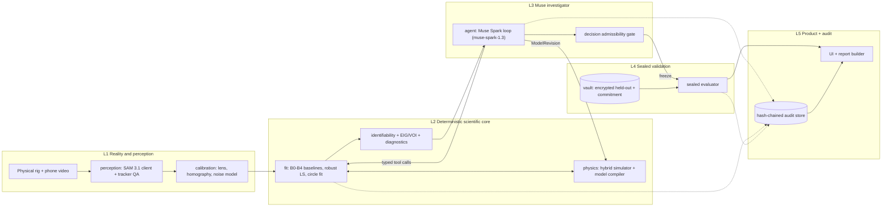
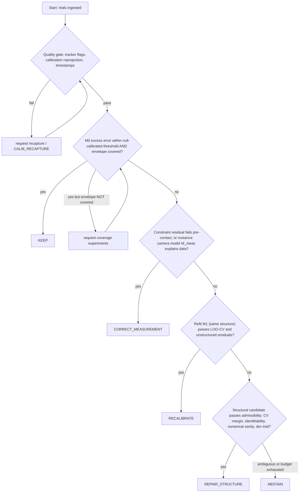
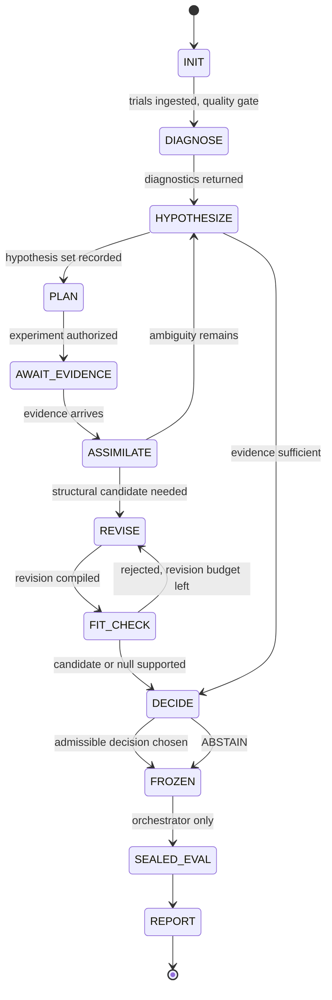

# REALIGN Build Spec v1 — Principal Architect Response (Complete)

> **Document scope:** Complete reproduction of the Build Spec v1 response: executive verdict, Sections A–H, Architecture Decision Records, POC-0 blueprint, red-team review, and final execution handoff.
> **Date of writing:** Saturday, October 31, 2026.
> **Status labels used throughout:** **Confirmed** (official source seen), **Likely** (secondary source or from memory), **Unverified** (needs owner check).

---

## Table of Contents

- [Part 1: Executive Engineering Verdict](#part-1-executive-engineering-verdict)
- [Part 2: REALIGN Build Spec v1](#part-2-realign-build-spec-v1)
  - [Section A: Architecture and Traceability](#section-a-architecture-and-traceability)
  - [Section B: Physics and Mathematical Foundations](#section-b-physics-and-mathematical-foundations)
  - [Section C: Research Baselines and Evaluation](#section-c-research-baselines-and-evaluation)
  - [Section D: Engineering Contracts and Typed Model Grammar](#section-d-engineering-contracts-and-typed-model-grammar)
  - [Section E: Muse Agent Architecture](#section-e-muse-agent-architecture)
  - [Section F: POC-0, Physics-Grounded Contradiction Detection](#section-f-poc-0-physics-grounded-contradiction-detection)
  - [Section G: Repository and Execution Plan](#section-g-repository-and-execution-plan)
  - [Section H: Hackathon Delivery](#section-h-hackathon-delivery)
- [Part 3: Architecture Decision Records](#part-3-architecture-decision-records)
- [Part 4: POC-0 Implementation Blueprint](#part-4-poc-0-implementation-blueprint)
- [Part 5: Red-Team Review](#part-5-red-team-review)
- [Part 6: Final Execution Handoff](#part-6-final-execution-handoff)

---

# PART 1: EXECUTIVE ENGINEERING VERDICT

## 1.1 Verdict

The five layers, two zones, the Meta model roles, the two simulator interfaces, the typed grammar and the Muse/numerics/validator split are sound. I reopen none of them. I **refine** them in Part 3.

The plan has seven problems that need fixing before code is written. They are fixable inside the frozen architecture.

| # | Issue in the attachment | Why it matters | Fix (section) |
|---|---|---|---|
| X1 | The peg is "a distance $d$ beneath the pivot," so the contact radius is $L-d$. That holds only for a peg on the vertical through the pivot. "Intermittently catches" implies off-vertical or amplitude-dependent contact. | The reset map and guards are wrong for a general peg. | General peg at polar position $(r_p,\varphi_p)$ (B.3). |
| X2 | The contact-mode damping $c_c$ is a separate free parameter. | If drag acts on the bob velocity, the rate $\gamma$ is mode-invariant. Only pivot friction is mode-dependent. A free $c_c$ makes B1 weaker than it should be, and a peg "win" could be a damping artifact. | Parametrize bob drag mode-invariantly. Pivot friction is a separate structural term (B.2). |
| X3 | The G5 target is "≥25% lower NRMSE than parameter-only fitting." | Near the noise floor this is meaningless: both methods sit at the floor and the ratio is noise. | Use noise-floor-corrected excess error with block-bootstrap CIs (C.5). |
| X4 | The LRT/BIC family is implied for "complex vs simple." | The peg parameters are unidentified under the null, so the LRT is non-standard (Davies problem). BIC is unreliable under misspecification. | Calibrate thresholds by Monte Carlo under the null, and decide by trial-level cross-validation (B.5). |
| X5 | The commit–reveal protocol is described as making the peg hidden "from the agent." | The commitment proves the geometry wasn't changed afterwards. It does not prove the agent didn't see the answer. **If Muse or SAM receives frames in which the peg is visible, the answer leaks.** | No raw video of sealed or exploration rigs goes to Muse. SAM prompts never mention the peg (E.9, red-team #5). |
| X6 | Experiments are "requested by the agent." Matched ablations (Muse vs B4 vs variants, many seeds) cannot each trigger live physical runs. | The comparison would not be fair or reproducible. | Pre-recorded **experiment library** with replay serving. Live runs are reserved for the flagship demo (C.7). |
| X7 | The roadmap has no schedule. | **Today is Oct 31. The stated deadline is Nov 4, 9:00 PM ET, which is about 02:00 UTC on Nov 5 if US DST ends Nov 1. That leaves about 4 days.** | The execution plan (G.3) is ordered so a submittable artifact exists at the end of each slice. Core and conditional work are separated (G.4). |

## 1.2 Where a deterministic stack probably matches Muse

For a peg on the vertical, B2 (two-circle fit) will probably diagnose the peg without any LLM. The attachment says so too. REALIGN's agentic claim therefore cannot rest on the peg diagnosis alone. It must rest on the Muse-necessity benchmark (E.8): out-of-library structure, off-grid experiments, measurement-fault disambiguation and abstention. If REALIGN does not beat B3+B4 there, the honest claim shrinks to "Muse-powered orchestration of a strong classical pipeline."

## 1.3 Decisions you must make before implementation

| D | Decision | My recommendation |
|---|---|---|
| D1 | Flagship peg geometry. | Two rig configs: R1 peg on the vertical (clean, B2-solvable) and R2 off-vertical ($\varphi_p\ne0$) so contact depends on amplitude. R2 is where active experiments matter. |
| D2 | Camera protocol. | Fixed phone, locked exposure and focus, stabilization off, ≥60 fps, planar fiducial board in the swing plane. |
| D3 | Library-plus-replay for benchmarks, live runs only for the demo. | Adopt (C.7). |
| D4 | Who installs the hidden peg and holds the salt. | A second person, or a physical enclosure. Publish the commitment hash before any investigation run. |
| D5 | No raw sealed-rig video to Muse. | Adopt. |
| D6 | Pre-register the decision loss matrix (E.7). | Do it before the first real run. |
| D7 | Rule items in A.9. | Check against your accepted-participant materials. |

---

# PART 2: REALIGN BUILD SPEC V1

## SECTION A: ARCHITECTURE AND TRACEABILITY

### A.1 Architecture



These are logical boundaries inside one Python package. The enforcement mechanism is an **import-linter contract**: `realign.agent` and `realign.tools` may not import `realign.validation` or `realign.vault`. The orchestrator is the only module that imports both sides.

### A.2 Package boundaries

| Package | Responsibility | May import | May not import |
|---|---|---|---|
| `contracts` | Pydantic schemas, units/dimensions | stdlib, pydantic | all others |
| `physics` | Hybrid simulator, analytic oracles, compiler, AST | contracts | agent, vault |
| `observation` | Camera model, noise model, projection | contracts, physics | agent |
| `perception` | SAM client, track QA, calibration | contracts, observation | agent |
| `fit` | Robust LS, baselines B0–B4, identifiability, EIG | contracts, physics, observation | agent, vault |
| `tools` | Agent-callable wrappers (typed, leak-scrubbed) | fit, physics, observation | vault, validation |
| `agent` | Muse client, state machine, prompts | contracts, tools | validation, vault, fit (direct) |
| `vault` | Encrypted held-out data, commit–reveal | contracts | agent, tools |
| `validation` | Sealed evaluator | contracts, physics, vault | agent |
| `orchestrator` | Freeze, phase tokens, zone control | all | none |
| `audit` | Hash chain, content store | contracts | none |
| `report`, `ui` | Evidence report, interface | contracts, audit | vault (except post-reveal) |

### A.3 Data flow

```
video.mp4 --(SAM 3.1)--> mask track --(QA+circle fit)--> Observation(px, t, cov, flags)
   --(calibration H, noise model)--> metric-plane track
   --> discrepancy / constraint-residual / fit tools
   --> EvidenceRecord (hash-chained) --> Muse
   --> ModelRevision --> compiler --> fit --> dev check (exploration zone)
   --> FrozenDecision (orchestrator) --> sealed evaluation --> reveal --> report
```

### A.4 Control flow for the five decisions



Precedence is measurement validity, then null, then parameters, then structure. A more complex branch is entered only after the simpler ones are rejected. Muse may choose among *admissible* outcomes and may always choose the more conservative one (ABSTAIN). It cannot choose an inadmissible outcome.

### A.5 Permission boundaries

| Resource | Agent | Numerical tools | Orchestrator | Sealed validator |
|---|---|---|---|---|
| Exploration-zone Observations | read via tools | read | rw | no |
| Library experiment requests | request | serve (replay) | authorize | no |
| Hidden peg geometry, salt | **never** | **never** | custody (encrypted) | read at reveal only |
| Sealed held-out trials | **never** | **never** | custody | read once, after freeze |
| Sealed outcomes | **never** | **never** | release after eval | write |
| ModelSpec compile | propose | compile | accept | read frozen spec only |
| Freeze | no | no | **yes** | no |

The tools return measurements and statistics only. Nothing returns a fault label or a ground-truth string. Leak tests: a **canary string** is planted in the vault and the geometry file. A CI test greps every prompt, tool output, log and report generated before reveal for the canary and for peg-geometry values.

### A.6 Persistent artifacts and provenance

- Content-addressed store: `artifacts/sha256/<hash>` holds videos, `.npz` tracks, specs and reports.
- `audit/chain.jsonl` has one record per action: `{seq, ts, zone, actor, tool@version, input_hash, output_hash, prev_hash, git_commit, lockfile_hash, model_id, api_response_id, tokens}`. Each hash covers the previous one, so a break is detectable by `verify_chain`.
- A `FrozenDecision` record holds the model-spec hash, parameters, decision, pre-registered predictions and the audit head hash. It is written before the vault key is released.
- Commit–reveal is `C = SHA256(canonical_json(geometry) ‖ salt32)`. Publish `C` (git tag plus a timestamped public post) before the first investigation run. At reveal, `verify_commitment.py` checks it.

**What the commitment proves:** the geometry wasn't altered after the commitment. **What it does not prove:** that the experimenter, who knows the geometry, did not influence agent inputs. The claim is only that the agent's inputs were mechanically blinded (X5), and the audit chain lets a reviewer check that.

### A.7 Failure handling

| Failure | Detection | Behavior |
|---|---|---|
| SAM API error or timeout | HTTP error, schema mismatch | Retry ×2 with backoff, then mark the trial `perception_failed`. No silent fallback in the headline path. A classical tracker is used only as a labeled audit. |
| Track dropout | `valid=False` frames, area or IoU jumps | Frames excluded from the likelihood, never interpolated. Trials with >X% dropout are quarantined. |
| Muse malformed output | Pydantic validation | Retry ≤2 with the validator message. Then log a failed turn. At the cap, force ABSTAIN with a partial report. |
| Compile error | `E_COMPILE_*` codes | Returned to the agent with the offending node path. Counts against the revision budget. |
| Fit divergence | Non-convergence, bounds hit | Multi-start (≥8) is attempted. If it still fails, `E_FIT_DIVERGED` is returned and the candidate is not admissible. |
| Experiment not in library | Snap distance > tolerance | `E_NOT_AVAILABLE`. The request counts against the budget. |
| API unavailable mid-run | Connection errors | Resume from the audit chain (state is a pure function of the log). Replay mode uses cached raw responses. |

### A.8 Requirements traceability matrix

| Capability | Justification | Judging criterion | Component | Verification | Demo artifact |
|---|---|---|---|---|---|
| Hybrid simulator with correct resets | Wrong transitions invalidate everything downstream | Technical depth (20%) | `physics.hybrid` | T-P1…T-P12 (B.8) | G1 verification table |
| SAM 3.1 measurement | Required Meta tool; the sole measurement source | Meta tooling (25%) | `perception` | Spot checks, QA flags, classical audit tracker | Overlay video of masks plus centroid |
| Calibrated, uncertainty-aware observations | Pixel-space comparison needs consistent frames | Technical depth | `observation`, `perception.calibration` | T-O1…T-O6 | Calibration panel with reprojection RMS |
| Baselines B0–B4 | Without them, "AI improvement" is unattributable | Technical depth, Impact | `fit` | Fairness audit (C.6) | Baseline table with CIs |
| Five-way decision with abstention | An agent that always repairs is wrong | Impact, Technical depth | `orchestrator.gate` | No-fault and ambiguous-case suites | Decision confusion matrix |
| Model grammar + compiler | Prevents arbitrary code execution, enables structural repair | Technical depth, Agentic bonus | `physics.compiler` | Compiler suite (D.4) | Revision diff view |
| Active experiment selection | The agent must act, not only analyze | Demo (25%), Agentic | `fit.eig`, `agent` | SBC calibration of EIG (B.7) | Experiment-request timeline |
| Sealed validation + commit–reveal | Independent proof, not self-certification | Impact, Demo | `vault`, `validation` | Leak/canary tests | Reveal clip, verifier script |
| Audit trail | Reproducibility, trust | Technical depth | `audit` | `verify_chain` in CI | Provenance panel |
| SimulationAdapter second model | Shows the contract is not pendulum-only | Impact (30%) | `adapters.example` | Contract tests | Audit run on an external simulator |
| Reproducible report | Reviewability | All | `report` | `make reproduce` | Public evidence report |

### A.9 Verified vs unverified external facts

| Claim | Status | Source or action |
|---|---|---|
| The hackathon runs Oct 26–Nov 4, 2026, hosted by Meta and Cerebral Valley. | Likely (secondary pages) | Secondary announcement pages state Meta organized it with Cerebral Valley and that it runs October 26 to November 4, 2026 (https://www.autobound.ai/companies/meta/news/call-for-applications-meta-global-ai-developer-hackathon-5c29e0b9). |
| Two tracks (indie, startup). Finals announced Nov 10. | Likely | Event listing describes indie developer and startup tracks, with finals and winners announced on 10 November 2026 (https://internshala.com/competitions/?p=12509). |
| Submission deadline is Nov 4, 9:00 PM ET. | Unverified by me | From your attachment, which cites the official page. Confirm the exact time zone in your rules. |
| Meta Model API at `api.meta.ai/v1`, OpenAI-style Responses API. | Confirmed (official docs domain) | The docs show Responses API calls against the base URL https://api.meta.ai/v1 using a `MODEL_API_KEY` (https://ai.developer.meta.com/docs/). |
| Muse Spark supports tool calling, structured output, and video, image and PDF input. | Confirmed (official docs) | The models page describes Muse Spark as multimodal, taking text, image, video, audio and PDF, and usable for tool calling and structured output (https://ai.developer.meta.com/docs/models/). |
| `muse-spark-1.3` exists and is recommended. | Likely (third-party) | A third-party summary lists Muse Spark 1.3 as the version Meta currently recommends, and lists SAM 3.1 pricing per 1,000 frames (https://www.orcarouter.ai/blog/muse-api). The official snippet I saw listed only 1.1 and 1.2. **Run the model-list smoke test.** |
| `sam-3.1` is served through the Responses API. | Likely (secondary) | A news summary states that SAM 3.1 is offered through the Meta Model API's Responses API under the name `sam-3.1` (https://www.mind-verse.de/news/meta-sam-3-1-bild-video-analyse-api). Whether it accepts video with temporal tracking in your account is unverified. |
| The "Contributor" tier may use completions for training. | Confirmed (official docs) | The docs say contributor-tier completions may be used to train future Meta models (https://ai.developer.meta.com/docs/models/). **Use the Standard tier only.** No sealed or hidden data may ever reach any API. |
| Rules to confirm: submission format and video length, repo visibility and license, pre-existing code declaration, AI-assistance disclosure, bonus prize criteria (including "Best Agentic Use-Case"), team and eligibility rules, consent for people in video, third-party libraries. | Unverified | Check your accepted-participant materials. I have invented none of these. |

---

## SECTION B: PHYSICS AND MATHEMATICAL FOUNDATIONS

Convention for each item: **Equation, Why, Implemented in, Verified by.**

### B.1 State-space model

- **Equation.** The mode set is $s\in\mathcal S=\{F,\;C_+,\;C_-\}$. $F$ is free swing about pivot $O$. $C_\pm$ is wrapped on the peg $P$ with wrap side $\sigma=\pm1$ (so the grammar needs no hidden sign state).
- The continuous state is $x=(q,\dot q)$. In mode $s$, $q$ is the bob angle from the downward vertical about that mode's pivot, with effective length $\ell_s$: $\ell_F=L$, $\ell_{C_\pm}=L-r_p$.
- Parameters: $\eta=(L,\;r_p,\;\varphi_p,\;\gamma,\;k_q,\;\kappa_{in},\;\kappa_{out},\dots)$ plus fixed $g$.
- Controls $u$: release angle $\theta_0$, release velocity (nominally 0), and nuisance release time $t_0$.
- Observations: $y_k\in\mathbb R^2$ (pixels).
- Plane frame: $X$ right, $Y$ up, origin at pivot $O$, gravity along $-Y$ in the **gravity-aligned** plane frame. The board may be tilted relative to gravity, which is handled by the nuisance $\alpha_g$ in B.4.
- Peg in the plane frame: $P=(p_x,p_y)=r_p(\sin\varphi_p,\,-\cos\varphi_p)$, with $0<r_p<L$ and $|\varphi_p|<\pi/2$.
- **Bob Cartesian position** (the kinematic map used by the compiler and the observation model):

$$
F:\; (X,Y)=(L\sin\theta,\,-L\cos\theta),\qquad
C:\; (X,Y)=(p_x+\ell_C\sin\psi,\; p_y-\ell_C\cos\psi)
$$

- **Why.** Continuous state plus an explicit mode set is what distinguishes structure from coefficients (attachment §3.1). Making $C_+$ and $C_-$ separate modes gives each guard a fixed crossing direction.
- **Implemented in** `physics/hybrid_pendulum.py`, `contracts/model.py`.
- **Verified by** T-P8, T-P9 (position continuity of the kinematic map across guards).

### B.2 Ordinary pendulum

- **Derivation.** Per unit mass, $\mathcal L=\tfrac12L^2\dot\theta^2+gL\cos\theta$. Euler–Lagrange gives $L^2\ddot\theta=-gL\sin\theta$.
- Add Rayleigh dissipation per unit mass, $R=\tfrac12\gamma\ell^2\dot q^2+\tfrac13 k_q\ell^3|\dot q|^3$, to get drag on the bob velocity $v=\ell\dot q$ with $a_t=-\gamma v-k_q|v|v$:

$$
\boxed{\ddot q=-\frac{g}{\ell}\sin q-\gamma\,\dot q-k_q\,\ell\,\dot q|\dot q|}
$$

| Symbol | Unit | Note |
|---|---|---|
| $g$ | m s⁻² | Fixed (9.80665 default). Local $g$ differs by ≲0.05%, so record the fixed value. |
| $\ell$ | m | Effective length to the bob's centre of mass (string length + radius to centre if attached at the surface). |
| $\gamma$ | s⁻¹ | Mode-invariant bob drag. Resolves X2. |
| $k_q$ | m⁻¹ | Quadratic drag. |

- **Rigid-bob correction (engineering approximation).** For a sphere of radius $R$, the true dynamics replace $g/\ell$ with $g\ell/(\ell^2+\tfrac25R^2)$. This is absorbed into $L$ in free mode but not exactly in contact mode. For $R=2$ cm, $\ell_C=0.2$ m, $L=0.6$ m, the induced length mismatch is $\approx0.4R^2(1/\ell_C-1/L)\approx0.5$ mm. A systematic-error-budget test (T-P12) reports this as predicted pixel error against $\sigma_{pix}$.
- **Why.** Standard mechanics. Bob-drag parametrization avoids the $c_c$ ambiguity (X2). Pivot friction, which would be mode-dependent, enters as a separate grammar term.
- **Implemented in** `physics/hybrid_pendulum.py`.
- **Verified by** T-P1 to T-P4.

### B.3 Peg-contact pendulum

**Dynamics.** $F$: B.2 with $\ell=L$. $C_\pm$: B.2 with $\ell=\ell_C=L-r_p$ and angle $\psi$.

**Guards and resets.** The string is straight along the line through $O$ and $P$ exactly when $\theta=\varphi_p$ (point-peg idealization).

| Transition | Guard | Crossing | Reset |
|---|---|---|---|
| $F\to C_+$ | $\theta-\varphi_p=0$ | increasing, $\dot\theta>0$ | $\psi^+=\varphi_p$, $\;\dot\psi^+=\kappa_{in}\dfrac{L}{\ell_C}\dot\theta^-$ |
| $F\to C_-$ | $\theta-\varphi_p=0$ | decreasing, $\dot\theta<0$ | same |
| $C_+\to F$ | $\psi-\varphi_p=0$ | decreasing, $\dot\psi<0$ | $\theta^+=\varphi_p$, $\;\dot\theta^+=\kappa_{out}\dfrac{\ell_C}{L}\dot\psi^-$ |
| $C_-\to F$ | $\psi-\varphi_p=0$ | increasing, $\dot\psi>0$ | same |

- **Why these resets.** At engagement the string is straight and tension is along it, perpendicular to the velocity. No impulse acts. The Cartesian bob position is continuous (T-P8), and the speed is continuous when $\kappa=1$:

$$
v^+=\ell_C\dot\psi^+=\kappa_{in}\,L\dot\theta^-=\kappa_{in}\,v^-
$$

- Angular rate **jumps** by $L/\ell_C>1$ even though speed is continuous. This is the core hybrid-systems subtlety.
- **Energy.** Per unit mass $E=\tfrac12\ell_s^2\dot q^2+gY$. With $\gamma=k_q=0$ and $\kappa=1$, $E$ is conserved across transitions. With $\kappa_{in}\ne1$, $\Delta E=\tfrac12v^{-2}(\kappa_{in}^2-1)\le0$.
- **Identifiability gauge.** Only $\kappa_{in}\kappa_{out}$ is observable through a full contact excursion. Report the product; fix $\kappa_{out}=1$ by default.
- **Taut-string condition.** The radial equation gives $T/m=\ell\dot q^2+g\cos q$ (drag has no radial component). Require $T>0$. A terminal event on $T=0$ raises `SLACK_VIOLATION`, which means the model is out of domain. REALIGN has no slack or projectile mode, and it must not silently simulate through one.
- **Feasibility, vertical peg.** Energy gives $\cos\psi_t=\big(L\cos\theta_0-d\big)/(L-d)$, where $d=r_p$. In general:

$$
\cos\psi_t=\cos\varphi_p-\frac{L}{\ell_C}\big(\cos\varphi_p-\cos\theta_0\big)
$$

  Contact experiments need $\cos\psi_t\ge0$ for taut motion. Under the posterior, experiments with $P(\text{slack})>1\%$ are infeasible.
- **Contact set.** The bob catches the peg only if its swing crosses $\theta=\varphi_p$. Released from rest at $\theta_0$, **contact occurs iff $|\theta_0|>|\varphi_p|$** (or $\theta_0$ is on the peg side of the vertical, depending on sign). For $|\theta_0|<|\varphi_p|$ the peg parameters $(r_p,\kappa)$ have exactly zero sensitivity. This "unexcited" regime drives the active-experiment story (B.6, B.7) and requires an envelope-coverage rule for KEEP (A.4).
- **Edge cases.** Guard-at-start: after a reset the state sits exactly on a guard. Event handling must use direction-filtered events plus an "armed" flag (T-P10). Grazing, where the turning point is within numerical tolerance of $\varphi_p$, is flagged `GRAZING` and excluded from fits. $r_p\to0$ must reduce continuously to $F$. $\ell_C\ge\ell_{min}$ is enforced (default $0.05L$) because $L/\ell_C$ blows up. Finite peg radius $\rho_p$ is neglected. Require $\rho_p\le0.02\,\ell_C$ or enable a `peg_radius` term, and report the predicted pixel error.
- **Planarity assumption.** Single-plane motion. Check it with the radius-constancy diagnostic in B.4.
- **Implemented in** `physics/hybrid_pendulum.py` using `scipy.integrate.solve_ivp` (DOP853, `rtol=1e-10`, `atol=1e-12`, terminal events, `dense_output`). Event handling is a custom loop with `max_events=200`.
- **Verified by** T-P5 to T-P12.

### B.4 Observation model

$$
y_k=\pi\!\big(H\,\mathcal T_{\alpha_g}\,p(x(t_k+\tau_k),s)\big)+\epsilon_k
$$

| Element | Specification | Implemented in | Verified by |
|---|---|---|---|
| Lens | `cv2.calibrateCamera` on checkerboard, undistort before measurement. Report reprojection RMS. | `perception/calibration.py` | T-O1 |
| Plane map | Homography $H$ from ≥4 coplanar fiducial corners (ArUco), metres to pixels. Report plane residual. | `observation/camera.py` | T-O2 |
| Gravity alignment | Plane may be tilted relative to gravity. Estimate $\alpha_g$ from a **stationary hanging recording** (the bob at rest defines the vertical). Nuisance with prior from that recording. | `observation/camera.py` | T-O3 |
| Pivot | Defined as the plane origin. Its pixel location is estimated from the fiducial board plus a weak prior. | same | T-O2 |
| Timestamps | Use container PTS, never the nominal fps. Phones can be variable frame rate. Fit nuisance offset $\tau_0$ (video start vs release). | `perception/video.py` | T-O4 |
| Rolling shutter | Row $v$ is captured at $t_k+(v/V-\tfrac12)t_{ro}$. $t_{ro}$ is a nuisance with a weak prior, applied in the predictor. | `observation/camera.py` | T-O5 |
| Centroid vs centre | Fit a circle to the mask contour (RANSAC) for the centre. Raw mask centroid is biased by string occlusion and blur. | `perception/track.py` | T-O6 |
| Out-of-plane | Planar-motion check: in mode $F$ the metric radius $\|p_k-O\|$ must equal $L$. **Constraint residual** $r_c=\|p_k-O\|-L$ is a model-independent diagnostic. | `fit/diagnostics.py` | T-D1 |

**Measurement covariance.** The whitened residual uses

$$
\Sigma_k=\Sigma_{loc}+\sigma_t^2\,\dot y_k\dot y_k^\top
$$

The second term propagates timestamp jitter along the velocity direction. $\Sigma_{loc}$ is estimated from a stationary recording, and **also** from repeated identical releases (dynamic noise floor), taking the larger. Temporal correlation, which SAM's tracker memory plausibly induces, is modelled as AR(1), $\epsilon_k=\phi^{\Delta k}\epsilon_{k-1}+w_k$. Whitening uses innovations $w_k$, with gap-aware $\phi^{\Delta k}$. Effective sample size is $N_{eff}\approx N(1-\phi)/(1+\phi)$.

**Missing frames and tracker failures.** Frames flagged by mask-area jump, IoU with the previous mask, centroid speed above physical bound, or SAM confidence are excluded from the likelihood. **They are never interpolated into data.**

### B.5 Parameter and model fitting

$$
(\hat\eta,\hat\nu)_M=\arg\min_{\eta,\nu}\;\sum_{j}\sum_{k\in\mathcal V_j}\rho\!\big(\|r_{jk}\|\big)+\tfrac12\|\eta-\eta_0\|^2_{\Sigma_0^{-1}},\quad r_{jk}=W_{jk}\,(y_{jk}-\hat y_{jk}(M,\eta,\nu))
$$

- $W$ is the whitening transform from B.4. $\rho$ is soft-$\ell_1$ or Huber with scale set from the whitened-residual MAD on the null fit.
- $\nu$ is the nuisance set: $t_0,\tau_0,\alpha_g,\omega_0$ (release velocity, prior $\mathcal N(0,\sigma_{\omega_0}^2)$) and a pivot shift with weak prior.
- Parameters are fit in log space with bounds. $L$ carries a tape-measure Gaussian prior (about 1 mm). Quantities with physical priors use them.
- **Initialization.** $L\leftarrow gT^2/4\pi^2$ from the small-amplitude period (zero-crossings), $\gamma$ from the log-decrement, and $(r_p,\varphi_p)$ from the circle fit (B2). **Multi-start ≥8**, and keep the best. Report every start's cost.
- **Solver.** `scipy.optimize.least_squares`, `method="trf"`, `loss="soft_l1"`.
- **Complexity control.** Three mechanisms, in order of authority:
  1. **Trial-level leave-one-trial-out CV** is the selection criterion. Frames are autocorrelated, so frame-level CV leaks.
  2. **Null-calibrated threshold.** Simulate from the fitted *null* model with the measured noise, refit both models, and record the distribution of the improvement statistic. Set the threshold from that distribution. This addresses X4, because the standard LRT $\chi^2$ asymptotics fail when peg parameters are unidentified under the null.
  3. BIC with $N_{eff}$ is reported as a secondary diagnostic only.
- **Implemented in** `fit/robust_fit.py`, `fit/null_calibration.py`.
- **Verified by** T-F1 to T-F5.

### B.6 Identifiability

Three levels, each producing a typed `EvidenceRecord`.

1. **Local sensitivity and FIM.** $S=\partial\hat y/\partial\eta$ (whitened, 3-point finite differences), $\mathcal I=S^\top S$. Report singular values, condition number, and the null-space direction in parameter terms. Zero singular value means structurally non-identifiable for that experiment set. Small ones mean "sloppy".
2. **Profile likelihood** (Raue et al., 2009, Likely; verify DOI). For each parameter, profile the cost over a grid and read off the CI. A flat or one-sided profile means practically non-identifiable.
3. **Model distinguishability by cross-fitting.** For candidates $M_a,M_b$ and experiment $e$: generate noise-free data from $M_a$ at its best fit, fit $M_b$ to it, and let $D_{ab}(e)$ be the whitened residual norm left. If $D_{ab}(e)<\tau$ (where $\tau$ is the 95% quantile of the null residual distribution), the pair is **observationally equivalent under $e$**.

Known issues the tests must exhibit:

- Peg parameters are rank-deficient when all trials have $|\theta_0|<|\varphi_p|$.
- $\gamma$ and $\kappa$ partially trade off at a single amplitude. Different amplitudes break this, because damping scales with time and amplitude while the peg loss is per crossing.
- Pivot shift and tilt are partially confounded in a single-view planar projection.
- Minimum detectable effect (MDE) curve: the smallest $r_p/L$ detectable at α=5%, 80% power for a given experiment set. This is the G3 artifact.

**Implemented in** `fit/identifiability.py`. **Verified by** T-I1 to T-I5.

### B.7 Active experimental design

**Hypothesis set** $\mathcal H=\{M_0, M_1\text{(params)}, M_{meas}, M_{peg}, M_{teth}?\}$.

**Model weights** $w_m\propto\exp(\text{elpd}_{loo,m})$ from trial-level CV (pseudo-BMA, robust to misspecification). Muse never supplies numeric priors.

**Predictive distribution** (Laplace): $y_e\mid m\sim\mathcal N\!\big(\mu_m(e),\,\Sigma_e+J_{m}\Sigma_{\eta,m}J_m^\top\big)$.

**EIG for model discrimination.**

$$
\mathrm{EIG}_{model}(e)=I(H;Y_e\mid D)=\mathbb E_{m,y}\!\Big[\ln\frac{p(y\mid m,e)}{\sum_{m'}w_{m'}\,p(y\mid m',e)}\Big]
$$

Estimated by Monte Carlo with common random numbers (N≈2000). The simulator is cheap (ms), so the full MC is affordable. The conservative fallback is a pairwise Bhattacharyya bound.

**EIG for parameters** (linear-Gaussian closed form): $\tfrac12\ln\det\!\big(I+\Sigma_\eta^{1/2}J_e^\top\Sigma_e^{-1}J_e\Sigma_\eta^{1/2}\big)$.

**Selection.**

$$
e^*=\arg\max_{e\in\mathcal E_{feas}}\big[\mathrm{EIG}(e)-\lambda\,C(e)\big]
$$

- **Feasibility $\mathcal E_{feas}$:** release angle on marked positions, taut under posterior ($P_{slack}\le1\%$), within library or operator capability, within the validity envelope.
- **Cost** $C(e)=c_{time}\,n_{trials}+c_{op}\,\mathbb 1[\text{off-grid}]+c_{risk}$.
- $\lambda$ is **pre-registered, not tuned on results**. A sensitivity sweep is reported.
- **Decision-aligned variant** (used for stopping): expected value of information $\mathrm{EVOI}(e)=R_{now}-\mathbb E_y[R_{after}]$, where $R$ is the minimum expected loss under the pre-registered loss matrix (E.7).

**Validation of the planner itself.** Simulation-based calibration. Across ≥200 synthetic investigations, check that predicted EIG is monotonically related to the realized log-score gain (report Spearman ρ and the scatter). A planner whose EIG is uncorrelated with realized information gain is rejected.

**Implemented in** `fit/eig.py`, `fit/feasibility.py`. **Verified by** T-E1 to T-E4.

### B.8 Numerical verification

| ID | Test | Method | Tolerance |
|---|---|---|---|
| T-P1 | Small-angle period | Period vs $2\pi\sqrt{\ell/g}$ at $\theta_0\to0$ | relative ≤ 1e-7 |
| T-P2 | Large-amplitude period | Exact $T=4\sqrt{\ell/g}\,K(\sin\tfrac{\theta_0}{2})$, `scipy.special.ellipk(m=k²)` | relative ≤ 1e-7 |
| T-P3 | Energy conservation (lossless) | Drift over 100 periods | scales with `rtol`; must be ≪ 0.01 px-equivalent |
| T-P4 | Convergence | `rtol` sweep 1e-6…1e-12 | monotone error decrease, no stalls |
| T-P5 | **Quadrature oracle, lossless peg** | Segment time $\sqrt{\ell/g}\,\lvert F(u_b,k)-F(u_a,k)\rvert$ with $u=\arcsin(\sin(\cdot/2)/k)$, `scipy.special.ellipkinc` | event times ≤ 1e-8 s |
| T-P6 | Contact period, vertical peg | $T=\tfrac12T_L(\theta_0)+\tfrac12T_{\ell_C}(\psi_t)$, closed form | relative ≤ 1e-7 |
| T-P7 | Energy across transitions | $E$ conserved when $\kappa=1$, drops by exactly $\tfrac12v^{-2}(1-\kappa^2)$ otherwise | ≤ 1e-9 |
| T-P8 | Position continuity | Kinematic map $\lVert X^+-X^-\rVert$ at every event | ≤ 1e-9 m |
| T-P9 | Speed continuity | $v^+=\kappa v^-$ | ≤ 1e-9 |
| T-P10 | Events: chattering, grazing, armed-guard | Post-release states on guards; $\theta_0=\varphi_p\pm\epsilon$ | no infinite loops, `GRAZING` flagged, ≤ `max_events` |
| T-P11 | Time-reversal and mirror symmetry | Lossless: forward, flip $\dot q$, run back, recover state. Mirror $(\theta,\varphi_p)\to(-\theta,-\varphi_p)$ gives mirrored trajectory. | ≤ 1e-8 |
| T-P12 | Scaling and reductions | $L\to\lambda L$, $t\to\sqrt\lambda\,t$ invariance; $r_p\to0$ recovers $F$; no contact when $\lvert\theta_0\rvert<\lvert\varphi_p\rvert$; sensitivity budget for peg radius and rigid-bob correction | stated in px |
| T-U1 | Units | Dimensional checker on every ModelSpec | zero violations |

Numerical tolerances are tied to the measurement budget: the solver error must stay **below 1% of $\sigma_{pix}$** in predicted pixel position. The listed tolerances are initial values, to be tightened after the first run.

---

## SECTION C: RESEARCH BASELINES AND EVALUATION

### C.1 What REALIGN claims, level by level

| Level | Capability | What REALIGN demonstrates | Unproven / not claimed |
|---|---|---|---|
| 1 | Parameter estimation | B1 does it. Classical. | No novelty claim. |
| 2 | Selection among predefined structures | B3 does it. | No AI claim. |
| 3 | Composition from permitted primitives | Claimed only when the target structure is **not** in B3's library. The grammar is a finite combinatorial space, so this is large-library selection with provenance. | Open-ended invention. |
| 4 | Active experiment selection | EIG numerics (B4) do it. Muse's incremental part is off-grid proposals, measured by REALIGN vs B4. | Optimality. |
| 5 | Mechanism inference | Predictive improvement plus identifiability plus independent measurement of peg geometry plus **interventional validation**. | Uniqueness. Observationally equivalent mechanisms stay equivalent. |

**Predictive accuracy is not causal truth.** The one causal test we can afford is an intervention on the mechanism itself. In the sealed set, include trials with the **peg removed**. The revised model with the peg-contact structure deleted, and all other parameters kept, must predict them. If the repair gets the held-out prediction right but fails this, the "mechanism" was a curve fit. That is a diagnosis failure even if prediction passed.

Diagnosis and repair are scored separately.

### C.2 Baselines

| ID | Method | Precise definition | Question |
|---|---|---|---|
| B0 | Original simulator | $M_0$ with measured $L$, nominal $\gamma$. | Is there a discrepancy? |
| B1 | Fixed-structure fit | $M_0$ structure, free $(L,\gamma,k_q)$ + nuisance $\nu$, same fitter. | Does recalibration suffice? |
| B2 | One- vs two-circle geometry | Fit circles to the metric-plane track. Pre-contact: circle about $O$ with radius free. Post-contact segments: circle with free centre. Compare residual with Δ-AIC or CV on trials. Peg location = second circle centre. | Does simple geometry diagnose the peg? |
| B3 | Deterministic structural selection | Fixed library $\{M_0, M_1, M_{peg}\}$ (peg macro, no tether). All fitted, selected by the same null-calibrated CV rule. | Does deterministic selection explain structure? |
| B4 | Deterministic experiment planner | B3 plus EIG planner (B.7) over the same feasible set, same budget. | Does Muse add value beyond numerical planning? |
| REALIGN | Muse-guided | Same tools, same budgets, same stopping, same admissibility gate. | Incremental agentic contribution. |

Optional classical reference, not required to implement: SINDy (Brunton, Proctor, Kutz, PNAS 2016, Confirmed in your attachment), usable as a sparse-regression structural prior for B3 only if time permits.

**Expected outcome:** B2 and B3 solve the clean vertical-peg case. The comparison that can show a Muse contribution lives in the MNB (E.8).

### C.3 Case matrix

| Case | Synthetic | Real | Expected decision |
|---|---|---|---|
| No fault (negative control) | ✓ | R0 rig, no peg | KEEP |
| Parameter fault | length, drag changes | R3 (shortened string, added drag) | RECALIBRATE |
| Peg, vertical | ✓ | R1 | REPAIR_STRUCTURE |
| Peg, off-vertical | ✓ | R2 (amplitude-dependent contact) | REPAIR_STRUCTURE after exciting experiments |
| Measurement fault | tilt, scale, time offset, mid-trial shift | R4 (camera shifted or zoom changed between recordings) | CORRECT_MEASUREMENT |
| Elastic tether (conditional) | ✓ (identifiability first) | R5 only if G3 passes for the tether | REPAIR_STRUCTURE (out of B3 library) |
| Ambiguous | Small amplitude only, high noise, or equivalent hypotheses | R6 | ABSTAIN or request evidence |
| Corrupted measurement + real fault | Combined | R4+R1 | CORRECT_MEASUREMENT first, then structure |

### C.4 Data separation

- **Calibration** set: checkerboard, stationary hanging, rest recordings. Used only for noise and camera.
- **Exploration library:** pre-recorded, served by replay on agent request.
- **Development** trials: exploration zone, used for confirmatory checks and thresholds. Not sealed.
- **Sealed** trials: disjoint repeats and angles, encrypted in the vault, with file hashes committed before any agent run. Includes peg-removed interventional trials and no-fault controls.
- Further model revision after sealed evaluation requires a **new protocol and fresh independent trials**.

### C.5 Metrics

- **Excess error.** $\text{NRMSE}_{ex}=\sqrt{\max(\text{MSE}-\text{MSE}_{floor},0)}\,/\,L_{px}$. $\text{MSE}_{floor}$ is estimated from repeated identical releases after time alignment (half the pairwise residual variance). Raw NRMSE and the floor are always shown alongside.
- **Improvement claim (replaces the 25% rule).** An improvement over B1 is claimed only if $\text{MSE}_{B1}-\text{MSE}_{floor}>3\,\text{SE}$ and the paired block-bootstrap CI over **trials** (not frames) excludes zero. If both methods are at the floor, report "indistinguishable from the floor." A relative reduction target is chosen **after** the null-calibration distributions exist, and is pre-registered then.
- **Decision metrics:** confusion matrix over five decisions, **false structural-repair rate** (Clopper–Pearson CI on no-fault + parameter-fault trials), abstention quality (risk–coverage curve), posterior calibration (reliability, Brier score).
- **Structural recovery:** peg position error in mm and as a z-score against its own CI (CI coverage over synthetic runs), correct model class, interventional prediction error.
- **Experiment efficiency:** extra trials to reach a correct admissible decision, plus cumulative regret in EVOI terms.
- **Agentic cost:** turns, tokens, API calls.

### C.6 Fair agentic ablations

All arms share data, library, experiment budget, stopping rule and admissibility gate.

| Arm | Change |
|---|---|
| A1 | Muse with tools but no experiment requests |
| A2 | Muse without EIG scores (must choose experiments from diagnostics) |
| A3 | B4 (deterministic planner) |
| A4 | Muse with tool outputs shuffled across cases (should degrade; sanity check) |
| A5 | Muse restricted to the B3 library vs open grammar composition |
| A6 | K≥5 repeated Muse runs per case with different seeds (variance) |

Failure-reporting standard: every attempted run is listed, including aborted ones and ones where Muse selected inadmissible actions. No post-hoc case removal. Cherry-picked seeds are disallowed, and results are reported as k-of-K.

### C.7 Replay library

For benchmark runs, an experiment request is served from a **pre-recorded library** per rig config: signed release angles in a grid, ≥3 repeats each, stationary and calibration recordings. Requests snap to the nearest available experiment with the snap distance logged. Beyond a tolerance, the request returns `E_NOT_AVAILABLE`. The flagship demo includes at least one **live** operator-executed experiment chosen by the agent.

---

## SECTION D: ENGINEERING CONTRACTS AND TYPED MODEL GRAMMAR

### D.1 Core contracts (Pydantic v2 style)

```python
from __future__ import annotations
from typing import Annotated, Literal, Mapping, Optional, Protocol, Sequence, Union
from pydantic import BaseModel, ConfigDict, Field, model_validator
import numpy as np

class Frozen(BaseModel):
    model_config = ConfigDict(frozen=True, extra="forbid")

Dim = tuple[int, int, int]            # exponents of (length, time, mass); angle is dimensionless
class ArrayRef(Frozen):               # arrays live in the content store, never inline
    sha256: str; path: str; shape: tuple[int, ...]; dtype: str

# ---------- Perception / calibration ----------
class NoiseModel(Frozen):
    sigma_loc_px: tuple[float, float, float]      # (Sxx, Sxy, Syy) at rest
    sigma_dynamic_px: Optional[float]             # from repeats; used if larger
    ar1_phi: tuple[float, float]                  # per image axis
    sigma_t_s: float                              # timestamp jitter
    source_trial_ids: tuple[str, ...]

class Calibration(Frozen):
    id: str
    camera_matrix: tuple[tuple[float, ...], ...]  # 3x3
    dist_coeffs: tuple[float, ...]
    reproj_rms_px: float
    H_plane_to_px: tuple[tuple[float, ...], ...]  # metres (gravity-aligned plane) -> undistorted px
    plane_residual_px: float
    gravity_angle_rad: float; gravity_angle_sigma_rad: float
    pivot_px: tuple[float, float]
    readout_time_s: Optional[float]
    noise: NoiseModel
    fiducial_ids: tuple[int, ...]

class Observation(Frozen):
    trial_id: str
    t_s: ArrayRef                  # container PTS, not nominal fps
    px: ArrayRef                   # (N,2) circle-fit centre
    valid: ArrayRef                # (N,) bool
    flags: ArrayRef                # (N,) uint16 bitmask: AREA_JUMP, IOU_LOW, SPEED, OCCLUDED, ...
    mask_area_px: ArrayRef
    perception_model: str          # e.g. "sam-3.1"
    request_sha256: str; api_response_id: Optional[str]
    calibration_id: str

# ---------- Experiments / trials ----------
class ExperimentSpec(Frozen):
    kind: Literal["RELEASE", "REPEAT", "STATIONARY_REF", "CALIB_RECAPTURE"]
    release_angle_rad: Optional[float] = None     # signed; release from rest
    duration_s: float = Field(gt=0, le=60)
    n_repeats: int = Field(ge=1, le=10)
    constraints_checked: tuple[str, ...] = ()     # filled by feasibility checker
    est_cost: Optional[float] = None
    @model_validator(mode="after")
    def _release_needs_angle(self):
        if self.kind in ("RELEASE", "REPEAT") and self.release_angle_rad is None:
            raise ValueError("release_angle_rad required")
        return self

class Trial(Frozen):
    id: str
    zone: Literal["calibration", "exploration", "development"]   # sealed trials never get a Trial object in the agent zone
    rig_config_id: str                            # opaque id; carries NO fault label
    video_sha256: str
    experiment: ExperimentSpec
    observation: Optional[Observation] = None
    quality: Literal["ok", "degraded", "quarantined"] = "ok"
    recorded_at: str

# ---------- Model grammar (D.3) ----------
class Const(Frozen):  op: Literal["const"] = "const"; value: float; dim: Dim
class Param(Frozen):  op: Literal["param"] = "param"; name: str
class State(Frozen):  op: Literal["state"] = "state"; name: Literal["q", "qd"]
class Bin(Frozen):    op: Literal["add", "sub", "mul", "div"]; a: "Expr"; b: "Expr"
class PowI(Frozen):   op: Literal["powi"] = "powi"; a: "Expr"; n: int = Field(ge=-4, le=4)
class Un(Frozen):     op: Literal["neg", "sin", "cos", "tanh", "abs", "relu", "sqrt"]; a: "Expr"
Expr = Annotated[Union[Const, Param, State, Bin, PowI, Un], Field(discriminator="op")]

class ParamSpec(Frozen):
    name: str; dim: Dim; value: float
    lo: float; hi: float
    prior_mu: Optional[float] = None; prior_sigma: Optional[float] = None
    fit: bool = True; log_scale: bool = True

class ModeSpec(Frozen):
    name: str
    pivot_xy: tuple[Expr, Expr]                   # [L], plane frame
    length: Expr                                  # [L], > 0 over envelope
    potential_extra: Optional[Expr] = None        # U(q) per unit mass [L^2 T^-2]
    rayleigh: Optional[Expr] = None               # R(q,qd) per unit mass [L^2 T^-3]
    q_abs_max: float = Field(gt=0, le=3.14159)    # validity envelope (taut)

class ResetSpec(Frozen):
    q_plus: Expr; qd_plus: Expr
    loss_param: Optional[str] = None              # kappa in (0,1], else lossless

class GuardSpec(Frozen):
    from_mode: str; to_mode: str
    fn: Expr                                      # event when fn crosses 0
    direction: Literal[-1, 1]
    reset: ResetSpec

class ObsCorrection(Frozen):                      # observation-model structure, not dynamics
    tilt: bool = True; time_offset: bool = True
    pivot_shift: bool = False; scale: bool = False

class ModelSpec(Frozen):
    family: Literal["planar_one_dof_pendulum_hybrid_v1"]
    g: Const
    params: tuple[ParamSpec, ...]
    modes: tuple[ModeSpec, ...]
    guards: tuple[GuardSpec, ...]
    initial_mode: str
    obs: ObsCorrection
    parent: Optional[str] = None                  # sha256 of parent spec
    @property
    def version_id(self) -> str: ...              # sha256(canonical_json)

# ---------- Revisions (D.3) ----------
class FalsifiablePrediction(Frozen):
    experiment: ExperimentSpec
    statistic: Literal["max_residual_sigma", "turning_height_px", "period_ratio"]
    expected_lo: float; expected_hi: float        # pre-registered interval

class ModelRevision(Frozen):
    id: str; parent_model: str
    edits: tuple["Edit", ...]                     # discriminated union, D.3
    rationale: str                                # free text, never used in computation
    predictions: tuple[FalsifiablePrediction, ...]

# ---------- Investigation ----------
class Hypothesis(Frozen):
    id: str
    cls: Literal["NULL", "PARAM", "MEASUREMENT", "STRUCTURE"]
    description: str
    model_ref: Optional[str]                      # ModelSpec version_id
    plausibility: Literal["low", "medium", "high"]   # ordinal; NEVER enters likelihood
    status: Literal["open", "supported", "rejected", "equivalent_to_other"]
    evidence_ids: tuple[str, ...] = ()

class EvidenceRecord(Frozen):
    id: str
    kind: Literal["fit", "comparison", "identifiability", "experiment", "quality", "numerical_check", "diagnostic"]
    tool: str; tool_version: str
    input_sha256: str; output_sha256: str
    summary: Mapping[str, float | str | bool]     # statistics only; no labels
    prev_hash: str; zone: Literal["investigation"] = "investigation"

class InvestigationState(Frozen):
    phase: Literal["INIT","DIAGNOSE","HYPOTHESIZE","PLAN","AWAIT_EVIDENCE","ASSIMILATE",
                   "REVISE","FIT_CHECK","DECIDE","FROZEN","SEALED_EVAL","REPORT"]
    trial_ids: tuple[str, ...]; hypotheses: tuple[Hypothesis, ...]
    evidence_ids: tuple[str, ...]; models: tuple[str, ...]
    budget_remaining: Mapping[Literal["turns","tool_calls","tokens","experiments","revisions"], int]
    admissible_decisions: tuple[str, ...]
    audit_head: str
```

### D.2 Interfaces

```python
class AdapterManifest(Frozen):
    name: str; version: str
    state_units: Mapping[str, Dim]; param_units: Mapping[str, Dim]
    controls: Mapping[str, tuple[float, float]]           # name -> (lo, hi), SI
    outputs: Mapping[str, str]                            # name -> frame / unit description
    time_base: Literal["simulation_seconds"]
    coordinate_frame: str                                 # e.g. "plane: x right, y up, origin at pivot, gravity -y"
    observation_mapping: str                              # how outputs map to Calibration.H
    deterministic: bool

class SimResult(Frozen):
    t_s: ArrayRef; xy_m: ArrayRef; modes: ArrayRef
    events: tuple[tuple[float, str, str], ...]            # (t, from, to)
    flags: tuple[str, ...]                                # SLACK_VIOLATION, GRAZING, MAX_EVENTS

class SimulationAdapter(Protocol):
    def manifest(self) -> AdapterManifest: ...
    def simulate(self, exp: ExperimentSpec, params: Mapping[str, float],
                 t_eval: np.ndarray) -> SimResult: ...     # audit-only capability

class RepairableModel(SimulationAdapter, Protocol):
    @property
    def spec(self) -> ModelSpec: ...
    def apply(self, rev: ModelRevision) -> "RepairableModel": ...   # raises CompileError
    def sensitivity(self, exp: ExperimentSpec, params: Mapping[str, float]) -> np.ndarray: ...
```

**Rule:** a `SimulationAdapter` that is not a `RepairableModel` supports **audit and recalibration of declared parameters only**. The UI and README must say so.

### D.3 Edit semantics

| Edit | Preconditions | Effect | Compile checks | Error codes |
|---|---|---|---|---|
| `AddPotentialTerm(mode, U, new_params)` | `U` has dim L²T⁻², references only declared params and `q` | $U_{extra}\mathrel{+}=U$ | dims, bounded depth ≤6, ≤3 new params, smoothness warning | `E_DIM`, `E_UNDECLARED`, `E_DEPTH` |
| `AddDissipation(mode, kind, param)` | `kind ∈ {viscous, quadratic, coulomb_smooth}` | adds a Rayleigh term | dims, param > 0, Coulomb uses `tanh(qd/ε)` | `E_DIM`, `E_SIGN` |
| `SetGeometry(mode, pivot_xy\|length)` | new expressions of dim L | changes pivot or length | positive length over envelope, taut | `E_LENGTH_NONPOS`, `E_TAUT` |
| `AddMode(mode)` | name unique | adds a mode | kinematic map defined, dims | `E_DUP`, `E_DIM` |
| `AddGuard(from,to,fn,dir,reset)` | modes exist | adds an event | reset passes C2/C3 | `E_POS_DISCONT`, `E_ENERGY_GAIN` |
| `AddPegContact(r_p, φ_p, κ_in, κ_out)` | free mode exists | **vetted macro:** expands to modes $C_\pm$, the four guards and resets of B.3 | all of the above, `ℓ_C ≥ ℓ_min` | `E_PEG_*` |
| `SetObservationCorrection(...)` | declared flags only | enables nuisance tilt, time offset, pivot shift, scale | declared set only | `E_OBS` |
| `FreeParam/FixParam` | param exists | recalibration, **not structural** | bounds valid | `E_PARAM` |

The macro `AddPegContact` is provided for correctness. The same structure can be built from `AddMode`, `AddGuard` and `SetReset` primitives. Primitives-versus-macro is the L3 evidence axis (C.1).

### D.4 Restricted compiler

- **Allowed operators:** `const, param, state, add, sub, mul, div, powi (|n|≤4), neg, sin, cos, tanh, abs, relu, sqrt`. No `eval`, no `exec`, no user functions. Evaluation is a tree walk producing a vectorized NumPy closure.
- **Dimensions:** exponent triple $(L,T,M)$ inferred bottom-up. Addends must match. Arguments of `sin, cos, tanh` must be dimensionless. `sqrt` requires an even-exponent dimension and a checked non-negative domain. `q` is dimensionless, `qd` has $T^{-1}$.
- **Derivatives:** a closed-form AST differentiator ($\partial/\partial q$, $\partial/\partial\dot q$) for the allowed ops, tested against finite differences. `relu'` is a step. `abs'` is a smoothed sign with a warning.
- **Mode equation:** $\ell^2\ddot q=-g\,\ell\sin q-\partial_qU-\partial_{\dot q}R$.
- **Guard and reset semantics:**
  - Events fire on a signed crossing of `fn` in the declared `direction`.
  - Resets are evaluated at the event state.
  - After a reset the guard is "armed" only after the state leaves the guard surface (T-P10).
  - `max_events` (default 200) and `min_dwell` stop Zeno behavior.
- **Compile-time checks:**
  - **C1** dimensions.
  - **C2** position continuity: for sampled $q$ on each guard surface, $\|\text{pos}_{to}(q^+)-\text{pos}_{from}(q)\|\le10^{-9}$ m.
  - **C3** speed non-increase: $|v^+|\le|v^-|(1+10^{-9})$.
  - **C4** declared references.
  - **C5** reachability, no self-loops.
  - **C6** positivity of lengths and denominators over the envelope grid.
  - **C7** taut envelope.
  - **C8** smoothness warnings.
- **Numerical safety:** `np.errstate(all="raise")`, float64, bounded step count, `RuntimeError`→typed `E_NUMERICS`. No wall-clock-dependent behavior inside the simulator. A process-level safety timeout exists but is never used to alter results.
- **Versioning:** `version_id = sha256(canonical_json(spec))`. Every revision records its parent. The audit record holds `numpy`, `scipy` versions and the lockfile hash.
- **Error reporting:** `CompileError(code, node_path, message)`, returned to the agent verbatim so it can repair its proposal.

---


## SECTION E: MUSE AGENT ARCHITECTURE

### E.1 State machine



Transitions are enforced by the orchestrator, not the agent. After `FROZEN`, the agent has no further actions. Any budget exhaustion routes to `DECIDE` with ABSTAIN forced.

### E.2 Structured output

Every Muse turn must validate against one schema (tool-call or structured-output mode, smoke-tested):

```python
class TurnOutput(Frozen):
    reasoning_summary: str                       # logged; never executed
    action: Union[ToolCall, ProposeExperiment, ProposeRevision, Decide]
class Decide(Frozen):
    decision: Literal["KEEP","RECALIBRATE","CORRECT_MEASUREMENT","REPAIR_STRUCTURE","ABSTAIN"]
    cited_evidence_ids: tuple[str, ...]          # must exist and support the decision
    residual_risks: tuple[str, ...]
```

### E.3 Tools (all typed, all scrubbed)

| Tool | Input | Output | Never returns |
|---|---|---|---|
| `inspect_quality(trial_id)` | trial id | tracker flags, jitter, reprojection, timestamp stats | frames |
| `get_discrepancy(model_id, trial_ids)` | model, trials | whitened residual stats, structure tests (runs, autocorrelation), constraint residual, per-phase breakdown | fault labels |
| `fit_model(model_id, trial_ids, opts)` | model | params, CIs, cost, CV score, start summary | |
| `compare_models(ids, trial_ids)` | models | CV table, null-calibrated p, BIC | |
| `compute_identifiability(model_id, trial_ids)` | model | FIM spectrum, profiles, equivalence flags | |
| `score_experiments(candidates, hypotheses)` | candidates | EIG, EVOI, cost, feasibility, $P_{slack}$ | |
| `simulate(model_id, params, experiment)` | | handle plus summary statistics | |
| `validate_revision(revision)` | `ModelRevision` | compile result or `CompileError` | |
| `request_experiment(spec)` | `ExperimentSpec` | authorization and queue status | |
| `check_predictions(revision_id)` | | pass/fail on pre-registered predictions | |

**Never exposed to the agent:** hidden geometry, `rig_config_id` semantics, sealed outcomes, held-out data, the vault key.

### E.4 Hypothesis handling

Muse writes hypotheses with an ordinal plausibility. Numeric model posteriors come **only** from the numerical tools, using uniform model priors. The ordinal plausibility affects ordering of investigation, never likelihoods. Hypotheses found observationally equivalent under the available experiments are recorded as `equivalent_to_other` and reported, not collapsed.

### E.5 Revision protocol

1. Muse proposes a `ModelRevision` including ≥1 pre-registered `FalsifiablePrediction` for an experiment not yet used.
2. Compiler validates (D.4). Errors return to Muse.
3. The fitter fits the candidate on exploration trials.
4. The null-calibrated CV comparison and identifiability run.
5. The pre-registered predictions are checked on development trials. Failure rejects the candidate.
6. `REPAIR_STRUCTURE` becomes admissible only if steps 3–5 pass.

### E.6 Stopping rules

Stop when any of the following holds:
1. The leading hypothesis has pairwise cross-fit distinguishability $D>\tau$ against all rivals **and** CV margin over the null-calibrated threshold, with envelope covered.
2. $\max_e\mathrm{EVOI}(e)<\epsilon_{EVOI}$ (pre-registered).
3. A budget is exhausted: turns (default 30), tool calls (80), experiments (default 8), revisions (4), tokens per turn (4096).

### E.7 Admissibility gate and abstention

The orchestrator computes the admissible set from numerics (A.4). Pre-registered loss matrix $\mathcal L(d,\text{truth})$, with false repair most costly. For example, false REPAIR 5, false KEEP 3, wrong RECALIBRATE 2, ABSTAIN 1, in arbitrary units fixed **before any real run**. The values are a policy choice, not an empirical result. Report a sensitivity sweep.

ABSTAIN is required when: quality gate fails persistently, hypotheses remain observationally equivalent, the envelope is not covered and no feasible experiment would cover it, or the budget ends without admissibility.

### E.8 What Muse contributes, and how to disprove it

Plausible contributions beyond B4:
1. Composing structure not in B3's library.
2. Proposing off-grid or non-release experiments (calibration recapture, repeat to measure the noise floor).
3. Reconciling heterogeneous diagnostics (e.g., the constraint residual fails before contact **and** the timing is irregular).
4. Explaining and reporting.

**Muse-Necessity Benchmark (MNB).** Cases a fixed library plus fixed grid planner is **structurally unable** to solve:
- (a) out-of-library structure (tether, two pegs, pivot friction plus peg);
- (b) a mid-trial camera shift that requires a recapture action;
- (c) conflicting evidence requiring a new diagnostic;
- (d) ambiguity requiring abstention instead of a forced choice.

**Disproof condition:** if, on ≥20 paired MNB cases with K≥5 seeds, REALIGN's success rate is not above B3+B4's by a paired exact sign test on discordant pairs (e.g., all ≥6 discordant pairs favoring REALIGN gives two-sided p≈0.031), the claim is withdrawn and reported as "Muse orchestrates but does not outperform." This is stated before running.

### E.9 Leakage controls and logging

- No raw video or frames reach Muse for exploration or sealed rigs (X5). SAM prompts are fixed: "the pendulum bob." The peg is never prompted.
- Tool outputs are schema-scrubbed. The canary test runs in CI (A.5).
- Standard-tier API only (A.9). No hidden data ever leaves the machine.
- Each turn logs the raw request hash and response, model id, reasoning summary, tool call, tool result hash, tokens and latency in the audit chain. Replay mode consumes cached responses and must reproduce the same final state.

---

## SECTION F: POC-0, PHYSICS-GROUNDED CONTRADICTION DETECTION

Build order: **P0.1 → P0.2 → P0.3/P0.4 → P0.5, P0.6 → P0.8 → P0.9**, with **P0.7 independent**. Do not build the agent until G1, G2 and the synthetic part of G3 have numbers.

| Component | Can build in parallel with |
|---|---|
| P0.0 environment + API smoke tests | everything (do first) |
| P0.1, P0.2 physics | P0.7 |
| P0.7 perception | P0.1–P0.6 |
| P0.3–P0.6 | each other once P0.2 and P0.4 exist |
| P0.8, P0.9 | require P0.5, P0.6, P0.7 |

### P0.0 Environment and Meta API smoke test
- **Module:** `scripts/smoke_meta.py`.
- **I/O:** env var `MODEL_API_KEY` → JSON report of model-list result, a 1-turn Muse call, a structured-output call, a tool-call round-trip, one SAM call on a short test clip.
- **Core:** exercise `https://api.meta.ai/v1` Responses API with `muse-spark-1.3` and `sam-3.1`. Record what the account actually supports (video input to SAM? tracking IDs? output format?).
- **Tests:** none. Output is evidence.
- **DoD:** report committed; model IDs in config; SAM capability documented.
- **Failure:** `muse-spark-1.3` not listed → fall back to the version the key lists and record it. SAM does not accept video → per-frame prompting plus tracker association, to be designed in P0.7.

### P0.1 Analytic pendulum oracles
- **Module:** `realign/physics/analytic.py`.
- **I/O:** `(L, g, θ0) → T`, `period_small`, `period_exact`, `segment_time(ℓ, A, a, b)`, `lossless_peg_period(L, r_p, φ_p, θ0)`.
- **Dependencies:** SciPy `ellipk`, `ellipkinc`.
- **Algorithm:** B.8 closed forms. The sign bookkeeping for turning points uses $u=\pm\pi/2$.
- **Tests:** T-P1, T-P2 (limits), consistency of `segment_time` summed to a half period equals $T/2$.
- **DoD:** oracle matches `ellipk` to 1e-12.
- **Failure:** sign errors for $\theta_0<0$ or $\varphi_p<0$.

### P0.2 Event-driven hybrid simulator
- **Module:** `realign/physics/hybrid_pendulum.py`.
- **I/O:** `(PendulumParams, ExperimentSpec, t_eval) → SimResult`.
- **Algorithm:** B.3 with DOP853, terminal direction-filtered events, armed-guard logic, slack event, `max_events`.
- **Tests:** T-P3 to T-P12.
- **Integration:** compare to P0.1 oracle for 200 random lossless configs, including off-vertical pegs and both release sides.
- **DoD:** all T-P pass. G1 table (error vs `rtol`, event-time errors, energy drift) generated by `python -m realign.physics.verify`.
- **Failure:** chattering, missed grazing events, silent slack.

### P0.3 Synthetic trajectory generator
- **Module:** `realign/synth/generator.py`.
- **I/O:** `(FaultConfig, seed) → TrueTrial` (ground truth labelled **only in the synthetic zone**, never exposed to tools).
- **Algorithm:** sample parameters from priors per fault class (C.3), simulate, project through the camera model.
- **Tests:** seed determinism (bitwise), class-conditional parameter ranges, serialization round-trip.
- **DoD:** 300 trials per class in seconds, reproducible from a seed list.
- **Failure:** ground-truth fields reaching the tool layer (tested by the canary).

### P0.4 Observation model and noise
- **Modules:** `realign/observation/camera.py`, `noise.py`.
- **I/O:** metric-plane positions + `Calibration` → pixel tracks. `NoiseModel` samples AR(1) noise, timestamp jitter, rolling-shutter skew, mask-bias, dropouts.
- **Defaults for synthetic design only** (replaced by measured values): 1080p, 60 fps, 0.5–1.5 px localization noise, φ in [0, 0.7], jitter 0.1–1 ms.
- **Tests:** T-O1 to T-O6. Projection round-trip, jitter propagation along velocity, whitening yields unit variance on synthetic noise.
- **DoD:** whitened residuals of the true model on synthetic data have mean χ²/dof ≈ 1 within sampling error.
- **Failure:** wrong homography orientation (gravity sign), inconsistent units.

### P0.5 Parameter-only baseline (B0/B1)
- **Module:** `realign/fit/robust_fit.py`, `baselines.py`.
- **Algorithm:** B.5 for $M_0$ with nuisance.
- **Tests:** T-F1 recover $(L,\gamma)$ on no-fault synthetic within CI coverage; T-F2 multi-start robustness; T-F3 the fit does **not** absorb a peg without a residual signature at large amplitude.
- **DoD:** coverage of 95% CIs between ~90% and 99% across 300 synthetic trials (this checks calibration, not a perfect score); a measured MDE curve.
- **Failure:** nuisance parameters absorbing real structure (tilt eats the second circle).

### P0.6 One- vs two-circle baseline (B2)
- **Module:** `realign/fit/circle_fit.py`.
- **Algorithm:** segment the track by curvature or by the free fit's residual onset. Algebraic then geometric circle fit (RANSAC). Compare via CV on trials.
- **Tests:** T-C1 exact recovery of peg centre on noiseless synthetic, T-C2 CI coverage vs noise, T-C3 failure when $|\theta_0|<|\varphi_p|$ (must report "no second circle," not a hallucinated one).
- **DoD:** a table of B2 detection rate and peg localization error vs $r_p/L$, noise, and amplitude. **This table determines how much of REALIGN's value can rest on the peg.**
- **Failure:** segmentation instability near the transitions.

### P0.7 Real video perception with SAM
- **Modules:** `realign/perception/sam_client.py`, `track.py`, `calibration.py`, `video.py`.
- **I/O:** video → `Observation` + QA flags.
- **Algorithm:** extract PTS with ffprobe. Call `sam-3.1` with the fixed prompt. For each mask: circle-fit centre, area, IoU with previous. Flag by rules in B.4. Undistort and map via $H$.
- **Independent audit:** classical Hough-circle tracker on the same frames, reported as a labeled cross-check (not the headline path).
- **Tests:** synthetic video rendering (render the simulator to frames, run the pipeline, compare to ground truth): bias and noise in px; timestamp handling on VFR clips; dropout handling.
- **Manual spot checks:** 20 random frames per trial, annotated overlay.
- **DoD (G2):** calibrated tracks with reported noise (static and dynamic), reprojection RMS, per-trial quality summary; tracking error small enough that the MDE from P0.5 is still useful.
- **Failure:** SAM identity switches onto the string or peg, mask bleeding, API cost overrun (monitor frames; at the Likely $0.20/1,000 frames, 20 s at 60 fps is about 1,200 frames).

### P0.8 Calibrated pixel-space comparison
- **Module:** `realign/compare/pixel_compare.py`.
- **I/O:** `(Observation, ModelSpec, params) → DiscrepancyReport` (whitened residuals, structure tests, constraint residual, noise-floor-corrected error).
- **Tests:** synthetic round-trip (true model → residual ≈ white); null calibration produces the expected false-positive rate.
- **DoD:** on synthetic data, no-fault false-alarm rate matches the calibrated α within CI.
- **Failure:** time alignment drift, double-counting correlated frames.

### P0.9 Baseline evidence report
- **Module:** `realign/report/baseline_report.py`; entrypoint `make poc0`.
- **Output:** HTML/Markdown with: G1 table, noise models, baseline table with block-bootstrap CIs, MDE curve, B2 detection table, real-vs-sim discrepancy plots, **explicit list of what fitting cannot explain**, and provenance.
- **DoD:** one command reproduces the report from a seed and raw data hashes. Real and synthetic results are visually and textually separated.
- **Failure:** synthetic and real results mixed in one figure.

### G1–G3 gate evidence

| Gate | Evidence | Stop |
|---|---|---|
| G1 Physics | P0.2 test suite + verification table | any T-P fails |
| G2 Perception | P0.7 report | tracking error prevents discrimination (compare to MDE) |
| G3 Discrimination | P0.5 MDE + P0.6 detection table + cross-fit distinguishability | all hypotheses observationally equivalent |

---

## SECTION G: REPOSITORY AND EXECUTION PLAN

### G.1 Repository

```
realign/
  pyproject.toml  uv.lock  .importlinter  Makefile  README.md  LICENSE
  configs/           models.yaml  rig_R*.yaml  loss_matrix.yaml  budgets.yaml
  src/realign/
    contracts/       model.py  trial.py  evidence.py  units.py
    physics/         analytic.py  hybrid_pendulum.py  ast.py  compiler.py  verify.py
    observation/     camera.py  noise.py
    perception/      sam_client.py  track.py  calibration.py  video.py
    fit/             robust_fit.py  baselines.py  circle_fit.py  null_calibration.py
                     identifiability.py  eig.py  feasibility.py  diagnostics.py
    tools/           registry.py  scrub.py
    agent/           muse_client.py  state_machine.py  prompts/  schemas.py
    vault/           commit.py  store.py
    validation/      sealed_eval.py
    orchestrator/    run.py  gate.py  freeze.py
    audit/           chain.py  store.py
    adapters/        example_external.py
    report/          baseline_report.py  evidence_report.py
    ui/              app.py
  tests/
    unit/  physics/  observation/  fit/  compiler/  agent/  leakage/
    integration/  poc0/  agent_synth/
    property/        (Hypothesis-based invariants)
  data/
    raw/      (videos, content-addressed)  synth/  library/  vault/ (encrypted)
  artifacts/ audit/ reports/
  docs/      protocol.md  rules_compliance.md  decisions/  
  scripts/   smoke_meta.py  verify_commitment.py  verify_chain.py
```

Libraries: NumPy, SciPy, OpenCV, Pydantic v2, pytest, hypothesis, import-linter, `cryptography` (vault), ffprobe. No microservices, no vector DB, no agent framework.

CI: `ruff`, `mypy` on `contracts` and `physics`, `import-linter`, unit + property tests, the canary leak test, `verify_chain`, and a quick `make poc0 --fast`.

### G.2 Dependency DAG

```
P0.0 ──┬──► P0.7 ─────────────────────────────┐
       │                                       ▼
P0.1 ─► P0.2 ─► P0.3 ─► P0.5 ─► P0.8 ─► P0.9 (G1,G2,G3)
              └► P0.4 ─┴► P0.6 ───┘
                                               │
                       ┌───────────────────────┘
                       ▼
  S5 compiler+grammar ─► S6 tools+vault+EIG ─► S7 Muse loop (synthetic)
                                                   │
                       S8 real peg library + commit-reveal ◄─ (parallel from day 1)
                                                   ▼
                              S9 sealed eval + ablations ─► S10 UI + report + demo
```

### G.3 Vertical slices (each ends with working code, tests, and evidence)

| Slice | Delivers | Evidence |
|---|---|---|
| S0 | Repo, CI, Meta smoke test | smoke report |
| S1 | Physics + oracles | G1 table |
| S2 | Synthetic + B1 + B2 | MDE curve, B2 table |
| S3 | SAM perception + calibration | G2 report, overlay video |
| S4 | **POC-0 baseline report on real + synthetic** | `make poc0` |
| S5 | AST, compiler, edits | compiler suite |
| S6 | Tools, vault, EIG, gate, audit chain | leak tests, SBC plot |
| S7 | Muse loop on synthetic, five decisions | decision confusion matrix |
| S8 | Real rig library, commitment published | library manifest |
| S9 | Sealed evaluation, MNB, ablations | paired results |
| S10 | UI, report, video | submission package |

**Schedule reality (X7):** about 4 days remain. S8 (physical recording) must start **now, in parallel**, because it is rig time rather than code time. Record the full R0–R4 libraries and calibration data on day 1–2, even before the software is ready.

### G.4 Core vs conditional

| Core (do not claim without) | Conditional (include only if gates pass) |
|---|---|
| S1–S4, S5 (peg + null + parameter + observation edits), S6, S7, S8 (R0–R4), sealed evaluation, five-way decision incl. ABSTAIN, B0–B4, audit chain | Elastic tether (needs G3-tether), second `SimulationAdapter` example, full MNB with K≥5, live-run polish, rich UI |

If time forces a cut, cut from the right column and state it plainly in the README. Never cut the baselines or the sealed evaluation.

---

## SECTION H: HACKATHON DELIVERY

### H.1 Proof sequence for judges

1. **Reality disagrees:** live rig and simulation overlaid. B0 residuals shown in noise units (not eyeballed).
2. **Meta perception:** SAM 3.1 mask track and calibrated trajectory, with the uncertainty band.
3. **Muse investigates:** the hypothesis list, with the tool results it cites.
4. **Informative experiment:** the agent asks for a larger release angle (the small-amplitude data cannot distinguish the hypotheses, showing the $|\theta_0|<|\varphi_p|$ blind spot) or a calibration recapture. One experiment is run **live**.
5. **Evidence changes the investigation:** posterior and admissible decisions update, shown on screen.
6. **Validated revision:** compiled `ModelRevision` diff, pre-registered predictions passing.
7. **Freeze, then sealed test:** frozen-spec hash and audit head shown **before** the vault opens.
8. **Reveal:** commitment hash verified on screen, true geometry compared with the recovered one, with CI.
9. **Transparency:** baseline table including where B2 matches REALIGN, abstention and no-fault results, limitations slide.

### H.2 What distinguishes it from a scripted animation

- Real recordings with raw video hashes and a public audit chain.
- A live, agent-chosen experiment.
- A pre-published commitment and a verifier anyone can run.
- Failures shown (an ABSTAIN case, a no-fault KEEP case, a case where B2 ties).
- `make reproduce` regenerates every table from raw data.

### H.3 Users and impact (stated at the scale we can support)

**Beneficiary:** a small robotics or controls lab (or course) with a simulation of a simple mechanism and a phone. Today, mismatch between simulation and a real rig is diagnosed by hand: is the camera off, are the parameters stale, or is the model wrong? REALIGN returns a decision, the next experiment to run, and an evidence report.

**What they would actually do:** film the mechanism at marked release positions, upload the clips, get the decision, run the experiments REALIGN requests, and receive a calibrated or structurally revised model with a report that records every numerical step.

**Scope honesty:** full structural repair works for **one-degree-of-freedom planar hybrid pendulum-class models** in the grammar. Other simulators get **audit and parameter recalibration** through `SimulationAdapter`. Do not claim industrial robotics impact. A second-simulator audit run is the most credible generality evidence, if it fits.

### H.4 Why Meta AI is integral

- **SAM 3.1** is the only measurement path for all headline real data. Without it there are no observations. The independent classical tracker is a labeled audit.
- **Muse Spark** emits every hypothesis, experiment and revision proposal in the log, and the MNB measures what it adds. If the measurement shows nothing, we say so.

### H.5 Technical-depth results to show

G1 verification table, calibrated noise models, null-calibrated false-positive rate, MDE curve, SBC plot for EIG, the baseline table with block-bootstrap CIs, the MNB paired results, the interventional (peg-removed) prediction.

### H.6 README outline

1. One-paragraph claim (the L1–L5 table, honestly scoped).
2. 60-second quickstart (`make demo-replay`).
3. Architecture diagram and the permission table.
4. Results with CIs, including negative results.
5. Reproduction (`make reproduce`), data hashes, commitment verification.
6. Limitations: grammar scope, human actuator, library replay, what is not proven.
7. Meta tooling usage and model IDs, tier and cost.
8. Compliance statement (pre-existing code declaration, AI-assistance disclosure if required, license).

### H.7 Evidence report layout

0 Summary and claim levels · 1 Apparatus and protocol (including commitment hash and timestamp) · 2 Physics verification (G1) · 3 Perception and noise (G2) · 4 Baselines · 5 Investigation transcript (tool calls and results, not hidden reasoning) · 6 Decision and admissibility · 7 Frozen model spec · 8 Sealed evaluation and reveal · 9 Ablations and MNB · 10 Failures and limitations · 11 Provenance and reproduction.

---


# PART 3: ARCHITECTURE DECISION RECORDS

| ID | Frozen decision | Refinement | Alternative rejected | Reopen if |
|---|---|---|---|---|
| ADR-1 | Five logical layers, one application | `import-linter` contract enforces layer boundaries | Microservices | Isolation requirements force separate processes |
| ADR-2 | Investigation vs sealed zones | Phase-token vault, encrypted blobs, hash-chained audit, canary leak test | Separate service for validation | Evidence of leakage that CI cannot catch |
| ADR-3 | `sam-3.1` + `muse-spark-1.3` | Smoke test first. **No raw rig video to Muse.** Standard tier only | Extra Meta models for count | SAM lacks temporal tracking, or 1.3 unavailable (use the listed version, record it) |
| ADR-4 | SimulationAdapter + RepairableModel | Manifest with units, frames, time base, controls, outputs. Audit-only vs repair stated in UI | Claim arbitrary simulator repair | A second simulator is demonstrated end to end |
| ADR-5 | Typed grammar, no free code | Potential/Rayleigh single-DOF grammar, AST differentiator, vetted macro plus primitives, C1–C8 compile checks | LLM-written Python; SymPy dependency | Experiments show the grammar cannot express the real fault |
| ADR-6 | Muse reasons, numerics verify | Admissibility gate: Muse chooses among numerically admissible decisions; ordinal plausibility never enters a likelihood | Muse certifies success | Gate blocks correct decisions systematically |
| ADR-7 | Hybrid simulator via SciPy events | **General peg $(r_p,\varphi_p)$, mode-invariant bob drag, $C_\pm$ modes, $\kappa_{in},\kappa_{out}$** | MuJoCo; fixed-vertical peg; free $c_c$ | Contact physics shows unmodelled stick-slip or slack |
| ADR-8 | Model selection | Trial-level CV plus Monte Carlo null calibration; BIC secondary | LRT with $\chi^2$ asymptotics | n/a (math error, not preference) |
| ADR-9 | G5 metric | Noise-floor-corrected excess error, block-bootstrap CI; target pre-registered after null distributions exist | Fixed 25% rule | n/a |
| ADR-10 | Evaluation protocol | Experiment library plus replay; live run for demo only | Live experiments for every ablation | Library coverage proves insufficient |
| ADR-11 | Commit–reveal | Third-party installer, published commitment, verifier script; claim stated as mechanical agent blinding | Claiming experimenter blindness | n/a |
| ADR-12 | Decision loss matrix | Pre-registered, sensitivity swept | Tuning on results | n/a |

---

# PART 4: POC-0 IMPLEMENTATION BLUEPRINT

### 4.1 Starting skeleton

```python
# physics/hybrid_pendulum.py
@dataclass(frozen=True)
class PegParams: r_p: float; phi_p: float; kappa_in: float = 1.0; kappa_out: float = 1.0
@dataclass(frozen=True)
class PendulumParams:
    L: float; g: float = 9.80665; gamma: float = 0.0; k_q: float = 0.0; peg: PegParams | None = None
@dataclass(frozen=True)
class SimOutput:
    t: np.ndarray; mode: np.ndarray; q: np.ndarray; qd: np.ndarray
    xy: np.ndarray                      # (N,2) metres, plane frame
    events: list[tuple[float, str, str]]; flags: list[str]
def simulate(p: PendulumParams, theta0: float, omega0: float, t_eval: np.ndarray,
             rtol: float = 1e-10, atol: float = 1e-12, max_events: int = 200) -> SimOutput: ...
def energy_per_mass(p: PendulumParams, out: SimOutput) -> np.ndarray: ...
```

```python
# physics/analytic.py
def period_small(L, g): ...
def period_exact(L, g, theta0): ...                          # 4*sqrt(L/g)*ellipk(sin(theta0/2)**2)
def segment_time(ell, g, amp, a, b): ...                     # |F(u_b,k) - F(u_a,k)| * sqrt(ell/g)
def lossless_peg_period(L, r_p, phi_p, g, theta0): ...
```

### 4.2 Test organization

```
tests/physics/  test_analytic.py  test_free_pendulum.py  test_peg_events.py
                test_peg_oracle.py  test_symmetries.py  test_numerics.py
tests/observation/ test_projection.py  test_noise.py  test_timing.py
tests/fit/      test_param_fit.py  test_circle_fit.py  test_null_calibration.py
tests/integration/poc0/  test_synth_to_report.py  test_real_clip_pipeline.py
tests/leakage/  test_canary.py  test_tool_scrub.py
```

`pytest -m "not slow"` runs in CI. The 200-config oracle sweep and the 300-trial coverage runs are marked `slow` and run nightly and before every milestone.

### 4.3 Integration sequence

1. P0.1 + P0.2 → **G1 table** (green before anything else).
2. P0.4 → P0.3 → P0.5, P0.6 → synthetic MDE and B2 tables.
3. P0.7 (started in parallel) → G2 report.
4. P0.8 joins real and synthetic → P0.9 baseline report.

### 4.4 Measurable definition of done for POC-0

- All T-P and T-U tests pass. Solver error is below 1% of $\sigma_{pix}$.
- 95% CI coverage for B1 on no-fault synthetic is between about 90% and 99%.
- Null-calibrated false-alarm rate matches α within its CI.
- B2 detection and localization table across $r_p/L$, amplitude and noise.
- SAM-derived tracks for real R0 (no peg) trials with measured static and dynamic noise, reprojection RMS, and a documented constraint residual.
- One command regenerates the report. Real and synthetic results are separated.
- No agent code has been written.

---

# PART 5: RED-TEAM REVIEW

| # | Failure | Detection | Mitigation |
|---|---|---|---|
| 1 | **B2/B3 solve everything**, so Muse adds nothing (G4 fails). | MNB paired test, pre-registered disproof | Report honestly. Build MNB cases (E.8). Pivot the claim to orchestration and abstention. |
| 2 | **Perception systematics** (rolling shutter, mask bleed onto the string, SAM jitter, VFR) swamp the signature. | Constraint residual, dynamic noise floor, classical audit tracker, MDE vs measured noise | Gate G2. Lock camera settings. Recapture. Abstain if MDE exceeds the effect. |
| 3 | **Spurious structure / false repair** (peg parameters unidentified under null, flexible model overfits). | No-fault suite, null-calibrated threshold, false-repair rate with CI | Trial-level CV, Monte Carlo thresholds, loss matrix with high false-repair cost, ABSTAIN. |
| 4 | **Prediction ≠ mechanism.** A damping artifact or camera effect mimics contact. | Interventional peg-removed trials, independent geometry reveal, cross-fit equivalence | Score diagnosis separately. Report equivalence classes. |
| 5 | **Leakage:** visible peg in frames, labels in filenames, operator notes, sealed outcomes, API retention (Contributor tier). | Canary test, tool-output scrub tests, import-linter, audit review | No raw video to Muse. Fixed SAM prompt. Opaque rig IDs. Standard tier only. Sealed data never leaves the machine. |
| 6 | **Meta API drift or limits** (model ID absent, SAM video unsupported, rate limits, structured-output failures). | P0.0 smoke test, schema validation, response caching | Record actual capabilities. Replay mode from cached responses. Document degraded paths. |
| 7 | **Hybrid-simulation errors** at transitions (chattering, grazing, slack, wrong reset). | T-P5 to T-P12, quadrature oracle, property tests | G1 is a hard stop. Slack raises `SLACK_VIOLATION`. |
| 8 | **Overclaiming generality** (arbitrary simulators, tether without identifiability, "invented structure"). | README claim table, G3-tether gate, adapter manifest | State audit-only vs repair. Tether claimed only after G3 passes on real data. |
| 9 | **Schedule:** about 4 days for physics + perception + agent + real data + video. | Daily artifact check at slice boundaries | Rig recording starts now in parallel. Core/conditional split. Cut conditional items first. |
| 10 | **Competitive:** "pendulum toy," single-run luck, live demo failure, "human does the experiments" read as scripted. | Reviewer test of README and video, K-run reporting | Workflow story with a lab user, second-simulator audit if possible, failure cases shown, recorded fallback, audit log proving agent-chosen experiments. |

---

# PART 6: FINAL EXECUTION HANDOFF

**First component to implement:** `realign/physics/hybrid_pendulum.py`, with its oracle `realign/physics/analytic.py`. Start the rig recordings (R0–R4 libraries, calibration set, stationary reference) in parallel, because that is rig time rather than code time.

**Exact inputs and outputs.** `simulate(PendulumParams, theta0, omega0, t_eval) → SimOutput(t, mode, q, qd, xy, events, flags)`, as in 4.1. Units are SI. The frame is gravity-aligned with origin at the pivot.

**Mathematical assumptions it relies on:**
- Point-mass bob, inextensible taut string, planar motion, point-peg contact, **no impulse at the transition** (tension is perpendicular to velocity at the straight-string instant).
- Speed is continuous across modes ($\kappa=1$). Angular rate jumps by $L/\ell_C$.
- Contact occurs iff the swing crosses $\theta=\varphi_p$.
- Drag is on bob velocity (mode-invariant $\gamma$).
- $T/m=\ell\dot q^2+g\cos q>0$ or the simulation raises `SLACK_VIOLATION`.

**Tests it must pass:** T-P1 to T-P12 and T-U1 (B.8), with the 200-configuration oracle sweep against `analytic.py`, including off-vertical pegs and both release sides.

**Next dependent component:** `observation/camera.py` and `noise.py` (P0.4), then `synth/generator.py` (P0.3), which cannot be trusted until G1 passes.

**Evidence to advance:** the generated G1 verification table: oracle agreement, convergence order, event-time error, energy accounting across transitions, symmetry and reduction checks, and the numerical-error budget expressed as a fraction of $\sigma_{pix}$. When that table is green and committed, build the observation model and synthetic generator. Meanwhile, the rig recordings and the P0.0 Meta smoke-test report must exist, because both determine what the perception slice can actually do.

**Remaining items I deliberately did not expand:** full prompt texts for Muse, the tether model's parameters and its G3 analysis, the UI layout, and the second-simulator adapter. None block POC-0.

---

*End of document.*
